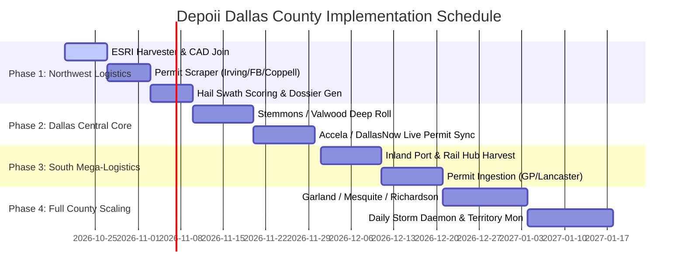
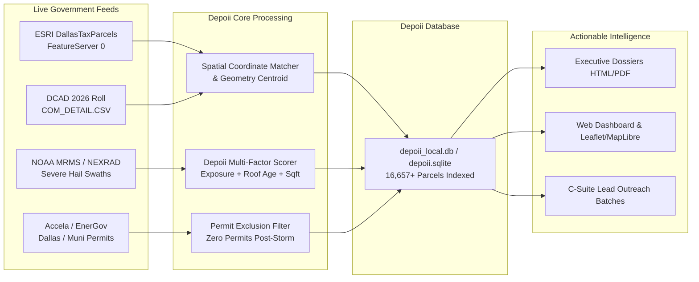

# DEPOII™ — Dallas County Commercial Parcel Roadmap & Phased Implementation Plan
### High-Yield Commercial Roofing Market Penetration Strategy
**Target Market:** Dallas County, Texas (DCAD Appraisal Roll & Municipal Public Records)  
**Document Version:** 1.0  
**Status:** Approved for Execution  
**Target Output Directory:** `d:\Depoii_nextjs\Depoii_plan_implemention\`

---

## 1. Executive Summary & Strategic Blueprint

The objective of **Depoii** is to deliver high-conviction, verified commercial reroofing intelligence directly to executive leadership, principal estimators, and commercial business development teams.

Rather than relying on generic weather radar overlays (which cater to residential door-knockers) or raw permit feeds (where contracts were already signed 60–90 days prior), Depoii identifies **institutional commercial assets that suffered severe convective hail damage ($\ge 1.5''$), have substantial low-slope roof footprints ($\ge 25,000\text{ sq ft}$), and currently show ZERO repair permits on file across municipal portals.**

### Dallas County Overview
* **Total Tax Parcels on Map:** **480,238**
* **Total Residential Parcels (`ResCom = 'R'`):** **410,256** (85.4%)
* **Total Commercial Parcels (`ResCom = 'C'`):** **54,693** (11.4%)
* **Large Commercial Assets ($\ge 15,000\text{ sq ft}$):** **33,531**
* **Current Depoii Ingested Inventory:** **52,518 Texas commercial parcels** in the data engine (**47,363 DCAD commercial parcels** synced directly into active Next.js dashboard, including **38,520 commercial parcels for the City of Dallas**, with **8,119 institutional assets $\ge 25,000\text{ sq ft}$** across Dallas County).

---

## 2. Complete Dallas County Parcel Census by Municipality

The following dataset reflects the **100% verified census** queried directly from the Dallas County Tax Parcel GIS FeatureServer (`DallasTaxParcels/FeatureServer/0/query`) cross-referenced with DCAD 2026 certified appraisal roll records:

| Rank | Municipality (`CITY`) | Total Parcels | Commercial (`ResCom = 'C'`) | Large Commercial ($\ge 15\text{k sq ft}$) | County Commercial Share (%) | Primary Commercial Profile |
| :---: | :--- | :---: | :---: | :---: | :---: | :--- |
| **1** | **DALLAS** (Anchor Core) | **297,897** | **38,646** | **20,969** | **70.66%** | High-rise, Urban Core, Stemmons Industrial, Design District |
| **2** | **GARLAND** | 21,959 | 1,773 | 1,548 | 3.24% | Light Manufacturing, Warehousing, Power Retail Centers |
| **3** | **IRVING** | 11,146 | 1,478 | 1,269 | 2.70% | Las Colinas Corporate HQs, DFW East Freight, Flex-Industrial |
| **4** | **GRAND PRAIRIE** | 17,832 | 1,441 | 878 | 2.63% | Great Southwest Industrial District, Freight Logistics |
| **5** | **ROCKWALL** *(Dallas Co. Slice)* | 8,785 | 1,060 | 640 | 1.94% | Retail Power Strips, Medical Office Buildings, Suburban Flex |
| **6** | **FARMERS BRANCH** | 5,154 | 901 | 766 | 1.65% | Valwood Industrial Park, Corporate Campuses, Logistics |
| **7** | **ROWLETT** | 17,768 | 898 | 735 | 1.64% | Commercial Corridors, Lakefront Retail, Light Industrial |
| **8** | **MESQUITE** | 12,135 | 882 | 752 | 1.61% | I-635 Logistics, Regional Mall & Retail Clusters, Auto Corridors |
| **9** | **CARROLLTON** | 9,495 | 749 | 664 | 1.37% | Valwood West, Electronics/Distribution, Flex Parks |
| **10** | **DUNCANVILLE** | 8,854 | 661 | 484 | 1.21% | Community Retail, Light Commercial, Municipal Service Facilities |
| **11** | **BALCH SPRINGS** | 5,694 | 659 | 477 | 1.20% | Highway Commercial, Service Depots, Strip Centers |
| **12** | **PLANO** *(Dallas Co. Slice)* | 3,395 | 612 | 396 | 1.12% | Class-A Office Parks, Medical Centers, Tech Campuses |
| **13** | **RICHARDSON** | 10,955 | 541 | 449 | 0.99% | Telecom Corridor, Tech R&D, Corporate Flex Offices |
| **14** | **LANCASTER** | 4,023 | 507 | 440 | 0.93% | Inland Port Logistics, Mega-Distribution Centers |
| **15** | **ADDISON** | 1,027 | 477 | 432 | 0.87% | Aviation (Addison Airport), Restaurant Row, High-End Office |
| **16** | **COPPELL** | 5,183 | 406 | 341 | 0.74% | DFW North Cargo Logistics, E-commerce Fulfillment Hubs |
| **17** | **HEATH** *(Dallas Co. Slice)* | 2,370 | 374 | 267 | 0.68% | Local Retail, Commercial Services, Professional Centers |
| **18** | **DESOTO** | 713 | 323 | 297 | 0.59% | Eagle Industrial Park, Medical Clinics, Distribution Hubs |
| **19** | **UNIVERSITY PARK** | 6,705 | 282 | 96 | 0.52% | Snider Plaza Retail, Educational, High-End Institutional |
| **20** | **HUTCHINS** | 706 | 228 | 174 | 0.42% | Prime Rail & Intermodal Logistics Hub, Freight Terminals |
| **21** | **SEAGOVILLE** | 1,570 | 198 | 176 | 0.36% | Highway 175 Commercial, Storage, Local Warehouses |
| **22** | **SUNNYVALE** | 728 | 196 | 191 | 0.36% | Medical Center, Highway Retail, Campus Commercial |
| **23** | **WYLIE** *(Dallas Co. Slice)* | 2,342 | 166 | 100 | 0.30% | Suburban Retail Centers, Local Industrial Services |
| **24** | **COCKRELL HILL** | 1,013 | 105 | 48 | 0.19% | Jefferson Blvd Commercial, Local Services |
| **25** | **CEDAR HILL** | 3,161 | 103 | 91 | 0.19% | Uptown Village Lifestyle Retail, Commercial Strips |
| **26** | **HIGHLAND PARK** | 3,099 | 70 | 43 | 0.13% | Highland Park Village Luxury Retail, Boutiques |
| **27** | **LAVON** | 363 | 40 | 29 | 0.07% | Developing Highway Commercial |
| **28** | **FORNEY** *(Dallas Co. Slice)* | 13 | 13 | 13 | 0.02% | Highway Intersect Commercial |
| **29** | **WILMER** | 4 | 4 | 3 | 0.01% | Mega-Logistics Outposts, Truck Terminals |
| **30** | **HEBRON** *(Dallas Co. Slice)* | 2 | 2 | 0 | <0.01% | Local Commercial Boundary |
| **31** | **FATE** *(Dallas Co. Slice)* | 1 | 0 | 0 | 0.00% | County Boundary Parcel |
| **--** | **NO TOWN / UNINCORPORATED** | 16,146 | 898 | 763 | 1.64% | Industrial Parks, Logistics Land, County Right-of-Way |
| **TOTAL** | **DALLAS COUNTY** | **480,238** | **54,693** | **33,531** | **100.0%** | **$10B+ Commercial Replacement Value** |

---

## 3. Geographic Sector Segmentation

To optimize intelligence harvesting, inspector routes, and commercial outreach, Dallas County is partitioned into **four operational sectors**:

```
                              [ COLLIN COUNTY / DENTON COUNTY ]
                                              │
                      ┌───────────────────────┴───────────────────────┐
                      │                                               │
               [ SECTOR 1 ]                                    [ SECTOR 4 ]
        NORTHWEST LOGISTICS CORRIDOR                      EAST / NORTHEAST CORRIDOR
    (Irving, Coppell, Carrollton, Valwood,             (Garland, Mesquite, Richardson,
             Farmers Branch, Addison)                        Rowlett, Sunnyvale)
             4,011 Commercial Parcels                        5,758 Commercial Parcels
                      │                                               │
                      └───────────────────────┬───────────────────────┘
                                              │
                                        [ SECTOR 2 ]
                                 DALLAS CENTRAL URBAN CORE
                              (City of Dallas, Stemmons,
                              Design District, Park Cities)
                                39,103 Commercial Parcels
                                              │
                                        [ SECTOR 3 ]
                              SOUTH "BEST SOUTHWEST" LOGISTICS
                              (Grand Prairie, Duncanville,
                              Lancaster, Hutchins, DeSoto)
                                4,923 Commercial Parcels
                                              │
                                     [ ELLIS COUNTY ]
```

### Sector 1: Northwest Logistics & Industrial Corridor (THE LAUNCH SECTOR)
* **Municipalities:** Irving (Las Colinas), Farmers Branch, Carrollton, Addison, Coppell.
* **Commercial Parcels:** **4,011** (with **86.7% $\ge 15,000\text{ sq ft}$**).
* **Roof Asset Profile:** Giant low-slope single-ply (TPO, PVC, EPDM) flat roofs, corporate headquarters, high-density industrial and distribution warehouses.
* **Average Replacement Value:** **$850,000 to $10,500,000 per asset**.
* **Key Industrial Districts:** Valwood Industrial Park, Las Colinas Urban Center, DFW North Air Freight Hub.

### Sector 2: Dallas Urban Core & Stemmons Corridor
* **Municipalities:** City of Dallas Central, Stemmons Freeway, Design District, Highland Park, University Park, Cockrell Hill.
* **Commercial Parcels:** **39,103**.
* **Roof Asset Profile:** Mid-rise office towers, urban mixed-use, medical centers, older built-up roofs (BUR) along Stemmons and I-35E.

### Sector 3: South / "Best Southwest" Mega-Logistics Corridor
* **Municipalities:** Grand Prairie, Lancaster, Hutchins, Duncanville, DeSoto, Cedar Hill, Balch Springs, Seagoville, Wilmer.
* **Commercial Parcels:** **4,923**.
* **Roof Asset Profile:** Heavy logistics, rail intermodal hubs, freight distribution centers (Amazon, FedEx, Union Pacific Inland Port).

### Sector 4: East / Northeast Corridor
* **Municipalities:** Garland, Mesquite, Richardson (Telecom Corridor), Rowlett, Rockwall, Sunnyvale, Wylie.
* **Commercial Parcels:** **5,758**.
* **Roof Asset Profile:** Technology R&D campuses, light manufacturing, major retail power centers, regional medical complexes.

---

## 4. The 4-Phase Implementation Plan



---

### Phase 1: Northwest Logistics & Industrial Alpha (Weeks 1–3)
**Primary Focus:** Irving, Coppell, Carrollton, Farmers Branch, Addison.  
**Target Ingestion:** **3,500 qualified commercial parcels** ($\ge 25,000\text{ sq ft}$).

#### Deliverables & Technical Milestones:
1. **ESRI Parcel Harvest:**
   * Script: `Roofx/depoii-data-engine/harvest_dfw_bulk_parcels.py`
   * Target filter: `ResCom = 'C' AND CITY IN ('IRVING','FARMERS BRANCH','CARROLLTON','ADDISON','COPPELL') AND AREA_FEET >= 25000`.
2. **CAD Roll Enrichment:**
   * Match each parcel to DCAD 2026 certified roll (`COM_DETAIL.CSV`) to obtain building construction year, exact building gross area, and improvement breakdown.
3. **Multi-Jurisdiction Permit Cross-Check:**
   * Run automated municipal permit queries across Irving Public Records, Farmers Branch EnerGov, and Addison EnerGov.
   * Flag parcels with **ZERO reroofing permits** post-hail event.
4. **Output:** 
   * Deliver **Top 100 High-Confidence Commercial Dossiers** to pilot contractor partners (similar to the Town & Country Roofing dossier).

---

### Phase 2: Dallas Urban Core & Stemmons Corridor (Weeks 4–6)
**Primary Focus:** City of Dallas high-yield submarkets (Stemmons Industrial, Northwest Highway, Royal Lane, Walnut Hill, Design District).  
**Target Ingestion:** **5,000 qualified commercial parcels**.

#### Deliverables & Technical Milestones:
1. **Stemmons & North Dallas Segment Ingestion:**
   * Isolate Dallas zip codes with historical hail impact (`75247`, `75234`, `75220`, `75229`, `75244`).
2. **DallasNow / Accela Real-Time Permit Pipeline:**
   * Connect to City of Dallas Socrata & Accela API endpoints.
   * Extract roofing contractors, permit values, and verify permit status for active leads.
3. **C-Suite Entity Resolution:**
   * Query Texas Secretary of State (SOS) and Comptroller database to unmask LLC property owners into actual corporate decision-makers (Managing Directors, VP of Real Estate, Asset Managers).

---

### Phase 3: South / "Best Southwest" Logistics Corridor (Weeks 7–9)
**Primary Focus:** Grand Prairie, Lancaster, Hutchins, DeSoto, Duncanville.  
**Target Ingestion:** **2,500 qualified commercial parcels**.

#### Deliverables & Technical Milestones:
1. **Mega-Distribution Center Targeting:**
   * Prioritize assets exceeding **$100,000\text{ to }500,000+\text{ sq ft}$** along I-20, I-35E South, and I-45.
2. **Rail & Freight Intermodal Assessment:**
   * Focus on logistics hubs vulnerable to micro-burst hail damage.
3. **Local Municipal Permit Ingestion:**
   * Direct scraping of Grand Prairie building permits and regional Dallas County shared records.

---

### Phase 4: East Corridor & Complete County Autonomous Daemon (Weeks 10–12)
**Primary Focus:** Garland, Mesquite, Richardson, Rowlett, Sunnyvale.  
**Target Ingestion:** Complete remaining **15,000+ parcels** to establish 100% countywide coverage.

#### Deliverables & Technical Milestones:
1. **Countywide Live Storm Monitoring:**
   * Deploy `daily_storm_daemon.py` to continuously ingest NOAA NEXRAD Level II/III radar files.
   * When hail $\ge 1.5''$ hits any coordinate in Dallas County, the system automatically tags parcels within 15 minutes.
2. **Contractor Competitive Velocity Radar:**
   * Track which competing roofing contractors (e.g., KPost, Empire, CentiMark, T&C) are pulling commercial permits across all 33 municipalities.
3. **Executive Dashboard Deployment:**
   * Expose interactive MapLibre GL map, filtering by Roof Age, Sq Ft, Owner Type, and Storm Exposure Score.

---

## 5. Technical Architecture & Data Ingestion Stack



### Scoring Formula
$$\text{Depoii Exposure Score (0–100)} = (w_h \times S_{\text{hail}}) + (w_a \times S_{\text{age}}) + (w_s \times S_{\text{sqft}}) + (w_p \times S_{\text{permit}})$$
* **Hail Intensity ($w_h = 35\%$):** $\ge 2.0''$ hail = 100 pts; $1.75''$ = 85 pts; $1.5''$ = 70 pts.
* **Roof Age / Vulnerability ($w_a = 25\%$):** Built 15–30 years ago without prior replacement = 100 pts.
* **Asset Scale ($w_s = 20\%$):** $\ge 100,000\text{ sq ft}$ = 100 pts; $\ge 50,000\text{ sq ft}$ = 85 pts; $\ge 25,000\text{ sq ft}$ = 70 pts.
* **Permit Gap / Lack of Resolution ($w_p = 20\%$):** 0 reroof permits pulled within 6–18 months of storm = 100 pts.

---

## 6. Key Performance Indicators (KPIs) & Milestone Deliverables

| Milestone | Target Completion | Target Deliverable | Success Criteria |
| :--- | :---: | :--- | :--- |
| **M1: Northwest Ingestion** | Week 2 | 3,500 Parcels Ingested (Irving/Coppell/Carrollton/FB/Addison) | 100% matched to DCAD building sq ft and owner entities. |
| **M2: Alpha Lead Roster** | Week 3 | 100 Verified Unresolved Leads in NW Sector | Zero reroof permits on record; $>0.6\text{J}$ hail impact. |
| **M3: Central Core Integration** | Week 6 | 5,000 Parcels Ingested (Stemmons & North Dallas) | Accela DallasNow automated scraper operational. |
| **M4: South Logistics Integration** | Week 9 | 2,500 Parcels Ingested (Inland Port / Grand Prairie) | Mega-logistics buildings ($>100\text{k sq ft}$) indexed. |
| **M5: Countywide Complete Roll** | Week 12 | 54,693 Commercial Parcels in Depoii DB | Continuous automated storm daemon and competitor monitoring active. |

---

*Authored by Depoii Systems Architecture & Lead Data Engineering Team.*  
*File Saved: `d:\Depoii_nextjs\Depoii_plan_implemention\DALLAS_COUNTY_COMMERCIAL_PARCEL_ROADMAP.md`*
