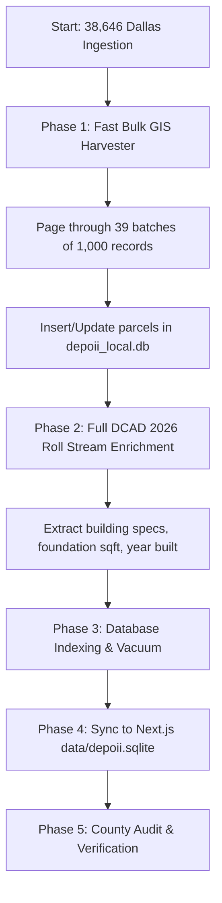

# Plan: County Core Full Scale Ingestion — All 38,646 Dallas Commercial Parcels

## 1. Executive Summary & Objective
* **Target:** Complete harvest and ingestion of **all 38,646 commercial parcels** designated as `CITY = 'DALLAS' AND ResCom = 'C'` from the official Dallas County GIS FeatureServer into Depoii's operational database engine (`depoii_local.db`) and web database (`depoii.sqlite`).
* **Current State:** 2,336 Dallas parcels in Next.js DB / 3,796 in Engine DB (primarily filtered to larger assets $\ge 25,000$ sq ft).
* **Target State:** **38,646 parcels** fully ingested, indexed with latitude/longitude centroids, joined to DCAD 2026 certified roll (`COM_DETAIL.CSV`), and classified into roof/asset tiers.

---

## 2. Technical Architecture & Constraints

### 2.1 ArcGIS Server Pagination
* **Endpoint:** `https://services2.arcgis.com/rwnOSbfKSwyTBcwN/arcgis/rest/services/DallasTaxParcels/FeatureServer/0/query`
* **Filter:** `ResCom = 'C' AND CITY = 'DALLAS'`
* **Total Records:** 38,646.
* **Pagination Strategy:**
  * Maximum query chunk: 1,000 records per request (`resultRecordCount=1000`).
  * Total API requests: 39 pages.
  * Adaptive retries with exponential backoff (1s -> 2s -> 4s) to prevent HTTP 504 / timeout drops.
  * Worker batch commits: SQLite transaction commit every 2,000 records to maintain atomic integrity without locking.

### 2.2 Enrichment Pipeline (DCAD 2026 Roll)
* **Source:** `data/dcad/DCAD2026_CURRENT.ZIP` -> `COM_DETAIL.CSV` (93,231 records).
* **Streaming Extraction:**
  * Read directly via streaming reader (`tar -xOf`) to keep memory footprint under 200 MB.
  * Join key: Standardized 17-digit `ACCOUNT_NUM` (stripping hyphens and whitespace).
  * Attributes populated: `building_sqft`, `footprint_sqft` (foundation area), `year_built`, `num_stories`, `property_class`, `construction_type`.
  * For unimproved commercial land parcels (parcels without buildings in `COM_DETAIL.CSV`), mark `building_sqft = 0` and `property_type = 'Commercial Land / Unimproved'`.

### 2.3 Strict Hygiene Guardrails
* Directional prefixes (`N`, `S`, `E`, `W`) strictly preserved.
* Primary key: `DCAD-PARCEL-{ACCT}`.
* URL Link: Deterministic link synthesis `https://www.dallascad.org/AcctDetailCom.aspx?ID={clean_account}`.
* Spatial coordinates: Centroid computed from polygon rings (`outSR=4326`).

---

## 3. Step-by-Step Implementation Sequence

### Phase 1: Bulk ArcGIS Ingestion Script (`harvest_dallas_full_38k.py`)
1. Create a memory-efficient, resumable harvester script.
2. Store checkpoint state (`dallas_full_harvest_checkpoint.json`) tracking `resultOffset` so execution can resume if a network glitch occurs.
3. Fetch attributes: `ACCT, GIS_ACCT, ST_NUM, ST_NAME, ST_TYPE, CITY, TAXPANAME1, TAXPAADD2, TAXPACITY, TAXPASTA, TAXPAZIP, AREA_FEET, PROP_CL, BUSNAME`.
4. Calculate polygon centroids `(centroid_lat, centroid_lon)`.
5. Insert into `depoii_local.db` table `parcels`.

### Phase 2: DCAD Roll Enrichment
1. Execute `enrich_dcad_parcels.py` across the newly populated 38,646 Dallas accounts.
2. Match against `COM_DETAIL.CSV`.
3. Fill physical building specifications, roof foundation area, and year built.

### Phase 3: Sync to Active Next.js Database (`data/depoii.sqlite`)
1. Run chunked SQLite transaction sync script to insert all 38,646 Dallas records into `data/depoii.sqlite`.
2. Ensure database indexes on `account`, `city`, `sqft`, and `(lat, lng)` are updated.

### Phase 4: Validation & Quality Control
1. Confirm exact parcel count: `SELECT count(*) FROM parcels WHERE city = 'Dallas'` equals 38,646 (or matches the exact count returned by ArcGIS server).
2. Tally commercial building breakdown:
   * Built commercial assets with gross building area.
   * Institutional assets $\ge 25,000$ sq ft.
   * Unimproved commercial lots (parking, storage, land).
3. Validate that UI map and table endpoints load smoothly with standard limit/offset pagination.

---

## 4. Resource & Time Estimates
* **API Harvest Time:** ~39 pages @ 0.5s delay = ~2–3 minutes total runtime.
* **DCAD Roll Stream Matching:** ~1 minute.
* **Next.js DB Sync:** ~15–20 seconds.
* **Total Estimated Execution Time:** ~4–5 minutes.
