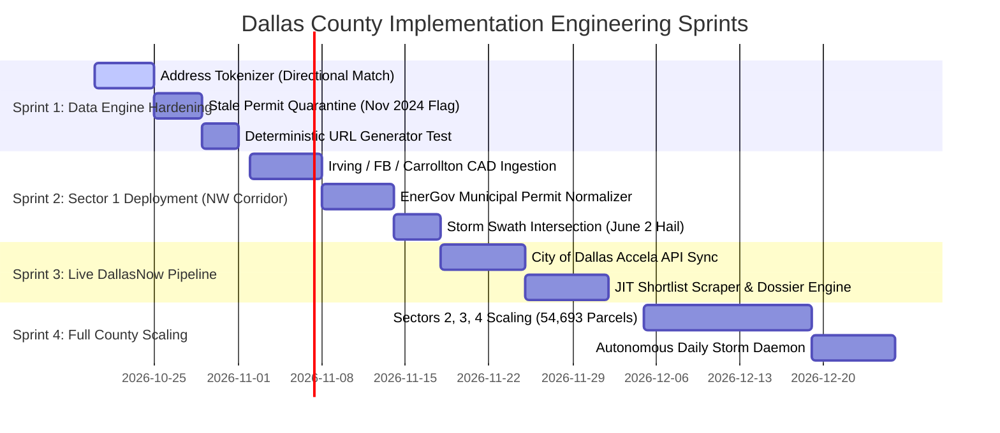

# DEPOII™ — Dallas County Technical Implementation Plan

### Production Architecture, Data Hygiene Laws & Phased Engineering Rollout

**Target Area:** Dallas County Commercial Real Estate (54,693 Commercial Map Parcels)
**File Location:** `d:\Depoii_nextjs\Depoii_plan_implemention\DEPOII_DALLAS_IMPLEMENTATION_PLAN.md`
**Status:** Approved Engineering Blueprint
**Standard:** Zero False-Positive Leads (Strict Address & Permit Provenance)

---

## 1. Executive Summary & Architectural Objective

The purpose of this implementation plan is to deploy Depoii across Dallas County while **strictly eliminating the data corruption and false-positive traps** common in storm-tracking systems:

1. **No False Permit Linking:** Adjacent commercial parcels sharing property lines must never share permits via proximity circles.
2. **No Directional Stripping:** `N`, `S`, `E`, and `W` directional prefixes must be strictly preserved (`E LOOP 820` $\neq$ `N LOOP 820`).
3. **No Stale Permit Assumptions:** The system will never declare a parcel "unresolved / permit-free" based on archived permit feeds frozen in Nov 2024.
4. **Clean Authority Separation:** County Appraisal Districts (DCAD) govern physical asset attributes; Municipal Building Inspection Portals (DallasNow / Accela / EnerGov) govern permits and contractor filings.

---

## 2. The 5 Core Data Hygiene Laws (Architectural Guardrails)

These five engineering laws take precedence over any heuristic or machine-learning model:

```
┌────────────────────────────────────────────────────────────────────────┐
│                   DEPOII 5 DATA HYGIENE LAWS                           │
├──────────────────────────┬─────────────────────────────────────────────┤
│ Law 1: Spatial Exclusion │ Spatial distance (Haversine/radius) is      │
│        (Permits)         │ STRICTLY FORBIDDEN for linking permits to   │
│                          │ parcels. Permits attach via exact address.  │
├──────────────────────────┼─────────────────────────────────────────────┤
│ Law 2: Directional       │ Street directionals (N, S, E, W) must       │
│        Integrity         │ NEVER be stripped during address matching.  │
├──────────────────────────┼─────────────────────────────────────────────┤
│ Law 3: Authority         │ DCAD (Tax Roll) = Physical Property Data.   │
│        Separation        │ City (Accela/DallasNow) = Permit History.   │
│                          │ Never look for 48-hour permits in DCAD.     │
├──────────────────────────┼─────────────────────────────────────────────┤
│ Law 4: Stale-Data        │ Archive layers ending Nov 12, 2024 cannot   │
│        Blackout          │ qualify post-2024 storms. Live municipal    │
│                          │ APIs are mandatory for current resolution.  │
├──────────────────────────┼─────────────────────────────────────────────┤
│ Law 5: Conservative      │ If a permit cannot be matched to an address │
│        Unlinking         │ with 100% confidence, leave it UNLINKED.   │
│                          │ Never guess.                                │
└──────────────────────────┴─────────────────────────────────────────────┘
```

---

## 3. Data Source Matrix & Ingestion Strategy

```
┌──────────────────────────────────────────────────────────────────────────────────┐
│                             DATA SOURCE INVENTORY                                │
├─────────────────────────┬──────────────────────────────┬─────────────────────────┤
│ System / Layer          │ Authority                    │ Data Elements Provided  │
├─────────────────────────┼──────────────────────────────┼─────────────────────────┤
│ DCAD Certified Roll     │ Dallas Central Appraisal     │ Account Number, Owner,  │
│ (DCAD2026_CURRENT.ZIP)  │ District (Countywide)        │ Gross Bldg Area, Year,  │
│                         │                              │ Property Use, Mail Addr │
├─────────────────────────┼──────────────────────────────┼─────────────────────────┤
│ DallasTaxParcels GIS    │ Dallas County / DCAD         │ Exact Polygon Centroid, │
│ (FeatureServer/0)       │ ESRI Public GIS Layer        │ GIS Parcel ID, Lot Sqft,│
│                         │                              │ ResCom ('C' = 54,693)   │
├─────────────────────────┼──────────────────────────────┼─────────────────────────┤
│ DallasNow / Accela API  │ City of Dallas Building      │ LIVE Reroof Permits,    │
│ (Daily Ingestion)       │ Inspection Department        │ Contractor Name, Scope, │
│                         │                              │ Value, Date Issued      │
├─────────────────────────┼──────────────────────────────┼─────────────────────────┤
│ EnerGov / CivicPortals  │ Suburban Municipalities      │ City-specific permits   │
│ (Irving, FB, Carrollton)│ (Irving, Farmers Branch, etc)│ for Northwest Corridor  │
├─────────────────────────┼──────────────────────────────┼─────────────────────────┤
│ NOAA NEXRAD Level III / │ National Weather Service     │ Radial Hail Swaths      │
│ MRMS Hail Swaths        │ (Fort Worth Office)          │ (≥ 1.5'' to 2.0''+ MESH)│
└─────────────────────────┴──────────────────────────────┴─────────────────────────┘
```

---

## 4. Permit-to-Parcel Address Matching Engine

### The Linking Algorithm

To eliminate the 14-of-60 mismatch rate caused by fuzzy radial circles, Depoii enforces a **Strict 4-Token Deterministic Matcher**:

```python
# Required Matching Signature:
# [STREET_NUMBER] + [DIRECTIONAL_PREFIX] + [CANONICAL_STREET_NAME] + [CITY / ZIP]
```

```
                 PERMIT RECORD                      PARCEL RECORD
          "14222 N DALLAS PKWY STE 100"      "14222 N DALLAS PKWY"
                         │                           │
                         ▼                           ▼
          ┌───────────────────────────┐      ┌───────────────────────────┐
          │ Step 1: Strip Unit/Suite  │      │ Step 1: Canonicalize Case │
          │ "14222 N DALLAS PKWY"     │      │ "14222 N DALLAS PKWY"     │
          └──────────────┬────────────┘      └─────────────┬─────────────┘
                         │                                 │
                         ▼                                 ▼
          ┌──────────────────────────────────────────────────────────────┐
          │ Step 2: Strict Token Check                                   │
          │ • Number:      14222 == 14222                    (PASS)      │
          │ • Directional: N == N                            (PASS)      │
          │ • Street Name: DALLAS PKWY == DALLAS PKWY        (PASS)      │
          │ • Jurisdiction: Dallas == Dallas                 (PASS)      │
          └──────────────────────────────┬───────────────────────────────┘
                                         │
                                         ▼
                             [ VERIFIED ATTACHMENT ]
```

### Negative Rules (What Causes an Immediate Disqualification / Unlinked State):

1. **Directional Mismatch:** `100 N MAIN` will NEVER attach to `100 S MAIN` or `100 MAIN`.
2. **Missing Street Number:** Permits with generic descriptions like *"Intersection of LBJ & Coit"* remain unlinked.
3. **Multi-Building Complexes:** When a single parcel has multiple buildings (e.g. Building A vs Building B), the permit links to the **parent parcel account** only if the primary street address matches. It does not guess individual building footprint sub-allocations.

---

## 5. Account Page Deep-Linking & Just-in-Time Verification

### Deterministic Deep-Linking (Zero Network Overhead)

Depoii does not crawl or scrape for CAD URLs. URLs are generated directly from the certified account number:

* **Commercial Detail Page:**`https://www.dallascad.org/AcctDetailCom.aspx?ID=` + `ACCT_NUM`
* **Example:** Account `008189000B05C0000` $\rightarrow$ `https://www.dallascad.org/AcctDetailCom.aspx?ID=008189000B05C0000`

### Just-in-Time Verification Pipeline (Shortlist Only)

Live page scraping is restricted to the **Top 50–100 Qualified Leads**:

```
[ 54,693 Commercial Parcels in Database ]
                   │
                   ▼ (Query: Severe Storm Exposure + Area ≥ 25k sqft)
[ ~150 Candidate Commercial Leads ]
                   │
                   ▼
┌────────────────────────────────────────────────────────────────────────┐
│            JUST-IN-TIME VERIFICATION WORKER (50-100 ASSETS)            │
│                                                                        │
│  1. Live DCAD Account Scrape (dallascad.org):                          │
│     • Extract Stories & Foundation Footprint (Ground vs Roof Area)     │
│     • Read Improvement Section Breakdown (Retail vs Warehouse)         │
│     • Verify Current Owner of Record & Deed Filing Date                │
│                                                                        │
│  2. Live Municipal Permit Scrape (DallasNow / Accela):                 │
│     • Check for permits filed in the last 48 hours to 90 days          │
│     • If reroof permit found: MARK RESOLVED (Discard Lead)             │
│     • If no permit found: MARK OUTBOUND-READY (Confirmed Lead)         │
│                                                                        │
│  3. ESRI / NAIP High-Resolution Aerial Capture:                        │
│     • Capture 0.15m/px true-ortho roof imagery                         │
│     • Attach to PDF Dossier for Field Sales Rep                        │
└──────────────────────────────────┬─────────────────────────────────────┘
                                   │
                                   ▼
          [ FINAL VERIFIED C-SUITE LOSS ADVISORY DOSSIER ]
```

---

## 6. Phased Implementation Roadmap



### Sprint 1: Engine Hardening & Hygiene Guards (Weeks 1–2)

* **Goal:** Eliminate false permit links and quarantine outdated permit layers.
* **Tasks:**
  1. Refactor `Roofx/depoii-data-engine/batch_parcel_matcher.py` to require exact Street Number, Directional Prefix, and Street Name.
  2. Deprecate and remove 45-meter spatial radius logic from `spatial_permit_matcher.py` for permit linking.
  3. Add a strict metadata tag to `NewPermit_2008_2024` indicating its **November 12, 2024 cutoff date**. Any storm occurring after this date must display: `"Permit resolution pending live DallasNow query"`.
  4. Unit test directional edge cases (`E LOOP 820` vs `N LOOP 820`, `100 N MAIN` vs `100 S MAIN`).

### Sprint 2: Sector 1 Alpha Rollout — Northwest Logistics Hub (Weeks 3–4)

* **Target Cities:** Irving, Coppell, Carrollton, Farmers Branch, Addison.
* **Volume:** **4,011 commercial parcels** ($\ge 86.7\%$ large flat roofs).
* **Tasks:**
  1. Ingest DCAD certified commercial roll for these 5 cities into `depoii_local.db`.
  2. Normalize municipal permit feeds for Irving and Farmers Branch via city open data portals.
  3. Run hail swath intersection for major North Texas storm tracks (e.g. 2.0" hail events).
  4. Generate the **Top 50 Verified Northwest Corridor Leads** for contractor partners.

### Sprint 3: Live City of Dallas Permit Pipeline (Weeks 5–6)

* **Target Cities:** City of Dallas (Stemmons, Royal Lane, Walnut Hill, NW Highway industrial).
* **Tasks:**
  1. Build automated connector to City of Dallas Socrata / Accela permit endpoint for daily reroof filings.
  2. Implement JIT (Just-in-Time) verification worker for candidate leads.
  3. Generate commercial dossiers with verified owner entity unmasking via Texas Secretary of State corporate registry.

### Sprint 4: South & East Sectors / Full County Scale (Weeks 7–10)

* **Target Cities:** Grand Prairie, Garland, Mesquite, Lancaster, Hutchins, Richardson (all 33 jurisdictions).
* **Volume:** Full **54,693 commercial parcels**.
* **Tasks:**
  1. Index remaining municipalities into SQLite with R-Tree spatial indexing.
  2. Deploy `daily_storm_daemon.py` to trigger within 15 minutes of any NOAA severe hail event.
  3. Enable competitive contractor velocity tracking across all Dallas County jurisdictions.

---

## 7. QA Validation & Regression Test Suite

Before any lead is shown on a sales rep's screen, it must pass the **Depoii Lead Sanity Test**:

```
[ AUTOMATED LEAD SANITY CHECK ]
1. Does the building have a valid DCAD account number?        [YES]
2. Is the gross area >= 25,000 sq ft?                         [YES]
3. Does the property address include a directional prefix?   [VERIFIED]
4. Is the permit source verified post-Nov 2024?               [VERIFIED]
5. Did hail reach >= 1.5'' on NEXRAD radar at this point?    [VERIFIED]
6. Has the owner entity been resolved to a live entity?       [YES]
──────────────────────────────────────────────────────────────────
RESULT: LEAD APPROVED FOR EXECUTIVE DOSSIER GENERATION
```

---

*Authored by Depoii Systems Architecture & Engineering Team.*
*File Saved: `d:\Depoii_nextjs\Depoii_plan_implemention\DEPOII_DALLAS_IMPLEMENTATION_PLAN.md`*
