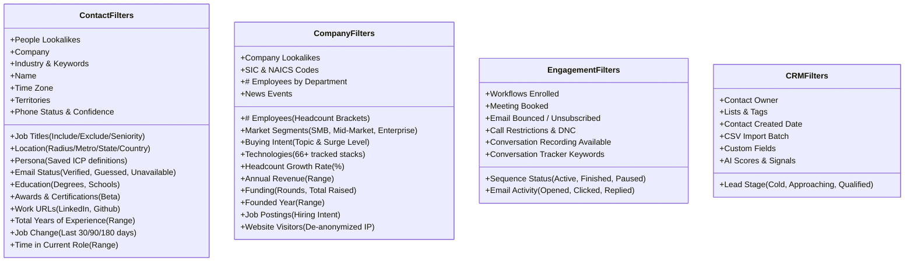
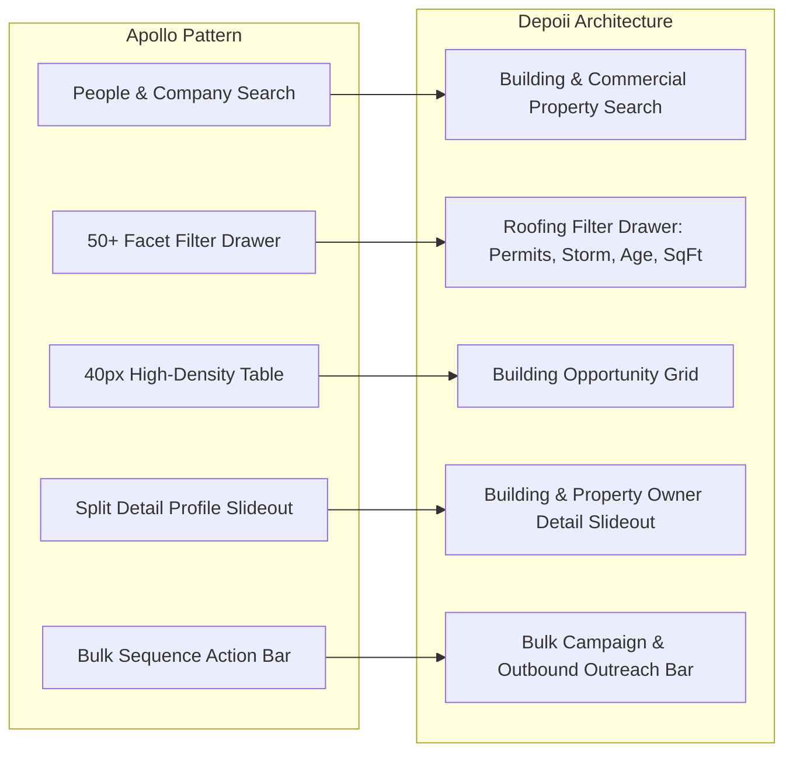

# Apollo.io UI/UX Reverse-Engineering Audit & Depoii Translation Blueprint

**Inspection Date**: November 3, 2026  
**Auditor**: Senior Product Designer & Design Systems Engineer  
**Inspection Environment**: Playwright Desktop Browser, Viewport: 1440 × 900 px (CSS Scaled)  
**Session Context**: Active authenticated Apollo.io workspace session  
**Target Focus**: Commercial Intelligence & Opportunity Engine Optimization (Depoii Blueprint)

---

## Executive Summary

Apollo.io is a multi-tenant B2B sales intelligence and go-to-market execution platform operating as a hybrid search engine, CRM, multichannel sequencer, and deal acceleration hub. This reverse-engineering audit investigated Apollo's live application interface, extracting its information architecture, high-density data tables, 50+ facet filter drawer, prospect/company detail drawers, command palette, and design system tokens.

### Key Architectural Findings:
1. **Density-First Data Grid**: Apollo utilizes a 40px compact row height data table capable of displaying up to 15+ rich columns without visual collapse, relying on sticky pinning, truncation with tooltips, and contextual hover actions.
2. **Progressive Filter Disclosure**: Rather than exposing 50+ search parameters upfront, Apollo displays a prioritized 5-item accordion rail (`Job Titles`, `Lookalikes`, `Company`, `Location`, `Industry`), hiding the remaining 45+ facets behind an expandable drawer.
3. **Dual-Pane Profile Split**: Contact and Company detail pages abandon single-page sprawl in favor of an asymmetric split: a fixed 340px metadata and quick-action rail on the left, and a tabbed activity/insight workspace on the right.
4. **Signature Visual Identity**: Apollo leverages an obsidian dark canvas (`#171714` / `rgb(23, 23, 20)`) paired with a high-contrast electric lemon primary action token (`#F2F764` / `rgb(242, 247, 100)`) and subtle low-opacity surface borders (`rgba(250, 250, 248, 0.08)`), setting it apart from traditional enterprise SaaS blues.

---

## 1. Product Architecture & Global Navigation

```mermaid
graph TD
    Root[Apollo.io Root Application] --> TopNav[Global Header Bar]
    Root --> SideNav[Collapsible Left Navigation Rail]
    Root --> Workspace[Primary Workspace Canvas]

    TopNav --> CmdK[Command Palette ⌘K]
    TopNav --> CreditMeter[Usage & Credit Meter Popover]
    TopNav --> AIAssistant[AI Assistant Slideout]
    TopNav --> Notif[Activity & Notifications]
    TopNav --> ProfileMenu[User Profile & Org Switcher]

    SideNav --> ProspectArea[Prospect & Enrich]
    SideNav --> EngageArea[Engage]
    SideNav --> WinDealsArea[Win Deals]
    SideNav --> ToolsArea[Tools & Automation]
    SideNav --> InboundArea[Inbound]
    SideNav --> SavedArea[Saved Records]
    SideNav --> SettingsArea[Admin Settings]

    ProspectArea --> PeopleSearch[People Search #/people]
    ProspectArea --> CompanySearch[Company Search #/companies]
    ProspectArea --> Lists[Lists #/lists]
    ProspectArea --> DataHealth[Data Enrichment #/enrichment-status]

    EngageArea --> Sequences[Sequences #/sequences]
    EngageArea --> Emails[Emails #/emails]
    EngageArea --> Calls[Calls #/phone-calls]
    EngageArea --> Tasks[Tasks #/tasks]

    WinDealsArea --> Meetings[Meetings #/meetings]
    WinDealsArea --> Conversations[Conversations #/conversations]
    WinDealsArea --> Deals[Deals / Pipeline #/deals]

    ToolsArea --> Workflows[Workflows & Plays #/workflows]
    ToolsArea --> Analytics[Analytics Dashboards #/analytics]

    InboundArea --> WebVisitors[Website Visitors #/websites]
    InboundArea --> WebForms[Forms #/forms]

    SavedArea --> SavedPeople[Saved People #/saved/people]
    SavedArea --> SavedCompanies[Saved Companies #/saved/companies]

    SettingsArea --> SettingsHub[Settings Hub - 46 Sub-pages #/settings]
```



### 1.1 Left Navigation Rail Specification
- **Position & Sizing**: Fixed left position, width `240px` expanded, collapsible to `64px` icon rail.
- **Visual Container**: Background `#171714`, right border `1px solid rgba(250, 250, 248, 0.08)`.
- **Category Accordion**: Each section (`Prospect and enrich`, `Engage`, `Win deals`, `Tools and automation`, `Inbound`, `Saved records`) has an expand/collapse toggle with a chevron icon (``).
- **Active Navigation Item**: Marked with an active background pill (`rgba(255, 255, 255, 0.08)`), left accent indicator, and bright text (`#FAFAF8`).
- **Footer Section**: Houses persistent CTAs: `Upgrade` badge, `Email setup and health` deliverability indicator, and `Admin Settings` link.


### 1.2 Global Header Bar Specification
- **Height**: `48px`, pinned sticky at the top (`z-index: 100`).
- **Global Search / Command Palette (`⌘K`)**: Centered search trigger button with placeholder *"Search or ask a question in Apollo"* and keyboard badge `⌘K`. Clicking opens a modal overlay with search history and AI prompt recommendations.
- **Credit Meter**: Displays live percentage (e.g., `100%`) with lightning icon. Clicking reveals a popover dialog showing email credit consumption (`0 of 85 credits used`), visual progress bar, and quick links to `View usage` or `Upgrade plan`.


---

## 2. Complete Screen Inventory

| Product Area | Page Name | Exact Route | Primary User Role | Primary Action (CTA) | Layout Model | Inspection Status |
|---|---|---|---|---|---|---|
| **Dashboard** | Home / Command Center | `#/home` | Account Exec / SDR | View Recommendations / Link Mailbox | Multi-widget Dashboard | **OBSERVED** |
| **Prospect & Enrich** | People Search | `#/people` | SDR / Growth Lead | Save Contact / Add to Sequence | Filter Drawer + Data Table | **OBSERVED** |
| **Prospect & Enrich** | Company Search | `#/companies` | SDR / Account Exec | Save Company / View Contacts | Filter Drawer + Data Table | **OBSERVED** |
| **Prospect & Enrich** | Lists Management | `#/lists` | Marketer / RevOps | Create a List | Split View Accordion | **OBSERVED** |
| **Prospect & Enrich** | Data Enrichment | `#/enrichment-status` | RevOps / Admin | Run Enrichment Job | Metric Status Cards | **OBSERVED** |
| **Saved Records** | Saved People | `#/saved/people` | SDR / Closer | Select Rows / Bulk Sequence | High-Density Table | **OBSERVED** |
| **Saved Records** | Saved Companies | `#/saved/companies` | SDR / Closer | Assign Owner / Add to List | High-Density Table | **OBSERVED** |
| **Contact Detail** | Person Profile | `#/contacts/:id` | Sales Rep | Add to Sequence / Add to List | Split Metadata + Tabbed Canvas | **OBSERVED** |
| **Company Detail** | Account Profile | `#/organizations/:id` | Sales Rep / Closer | Save Company / Prospect Leads | Split Metadata + Lead Table | **OBSERVED** |
| **Engage** | Sequences | `#/sequences` | SDR / Outbound Rep | Create Sequence (AI / Manual) | List + Workflow Builder | **OBSERVED** |
| **Engage** | Tasks | `#/tasks` | SDR / Account Exec | Create Task / Complete Task | Filtered Task Table | **OBSERVED** |
| **Win Deals** | Deals Pipeline | `#/deals` | Account Exec / VP Sales | Create Deal / Advance Stage | Kanban Board / Table View | **OBSERVED** |
| **Tools & Automation** | Workflows (Plays) | `#/workflows` | RevOps / Growth Lead | Create Workflow | Template Gallery + Canvas | **OBSERVED** |
| **Tools & Automation** | Analytics | `#/analytics` | VP Sales / RevOps | Create Dashboard / Report | Chart Grid + Metric Cards | **OBSERVED** |
| **Settings** | Workspace Settings Hub | `#/settings/overview` | Admin / Workspace Owner | Upgrade Plan / Invite Users | Grouped Hub Cards (46 pages) | **OBSERVED** |

---

## 3. Screen-by-Screen UI Specifications

### 3.1 Dashboard (`#/home`)
- **Visual Hierarchy**: Welcoming header (`Welcome, Ali 👋`) with a layout switcher (`Generate Pipeline`).
- **Card 1: Recommendations Engine**: Expandable accordion recommendations treegrid (`Try Apollo MCP`, `Add teammates to win deals together`) with Priority badges (`Important`), single-click action buttons (`Try MCP`, `Start`), and tri-action hover controls (`Dismiss`, `Mark Complete`, `Save`).
- **Card 2: Suggested Leads**: Radio toggle between `People` and `Companies`, backed by an empty-state card nudging users to configure a custom Scoring Model (`#/settings/scoring-models/create`).
- **Card 3: Email Performance Pulse**: 6-metric scoreboard: `# Emails sent`, `# Emails delivered`, `# Emails opened`, `# Emails replied`, `# Emails interested`, `% Emails bounced`.
- **Card 4: Inbox & Tasks Feed**: Multi-tab inbox categorized by response intent (`Willing to meet`, `Follow-up question`, `Referred`, `Out of office`, `Not interested`, `Unsubscribed`).


---

## 4. Advanced Search & Filtering System

Apollo's search and filtering architecture is one of the most sophisticated in B2B SaaS. It bridges a database of **250.2M people records** through faceted index structures.


### 4.1 Filter Hierarchy & Modality Segments
At the very top of the filter drawer, Apollo segments search results into 3 mutually exclusive scopes:
1. **Total** (`250.2M`): Complete global Apollo database.
2. **Net New** (`250.2M`): Records not yet saved or contacted by the workspace.
3. **Saved** (`102`): Records claimed, enriched, or owned by the current organization.

### 4.2 Complete 50+ Filter Inventory Breakdown



### 4.3 Filter UX Behavior & Patterns
- **Accordion Drawer**: Each category starts collapsed with an icon, title, and chevron. Clicking expands the inner filter form inline without page reload.
- **Include / Exclude Pill Operators**: In `Job Titles` and `Industry`, users can toggle a pill between green (Include) and red (Exclude).
- **Active Filter Pills & Count**: When a filter is set, a badge counter appears on the category header (e.g., `Owner 1`), and a removable pill tag appears above the table (`Contact Owner: Current User ✕`).
- **Clear All Affordance**: A dedicated `Clear all` button becomes active only when filters are applied, showing the count of active criteria.

---

## 5. High-Density Data Table Reverse Engineering

The core data grid in Saved People and Search Results is engineered for high information throughput.


### 5.1 Exact Table Anatomical Metrics (DOM Extracted)
- **Row Height**: Exactly `40px` (`height: 40px`, compact grid standard).
- **Row Background**: `rgb(23, 23, 20)` (`#171714`).
- **Row Hover State**: `rgb(35, 35, 30)` subtle lightened background elevation.
- **Header Cell Height**: `39px`, typography: `11px`, color: `rgb(185, 185, 178)` (`#B9B9B2`), uppercase, tracking: `0.05em`.
- **Border Treatment**: `1px solid rgba(250, 250, 248, 0.08)` bottom divider, zero vertical column borders.
- **Sticky Columns**: Checkbox column and `NAME` column are pinned left (`position: sticky`) during horizontal table scroll.
- **Table Virtualization**: Total canvas width spans `3040px` across 15+ columns. DOM uses dynamic virtualization to unmount cells outside the viewport scroll boundary.

### 5.2 Observed Columns Structure
1. `Checkbox`: Bulk selection trigger (`width: 40px`).
2. `NAME`: Avatar letter initial + full prospect name (`Mike Huddleston`, `Tina Hall`, etc.).
3. `STAGE`: Visual status pill (`Cold`, `rgb(250, 250, 248)`).
4. `LAST ACTIVITY DATE`: Hyphenated fallback (`-`).
5. `RECOMMENDATIONS`: AI signal badge.
6. `ACTIONS`: Contextual action trigger buttons.
7. `QUALIFY CONTACT`: Inline AI qualification agent trigger (`Click to run`).
8. `COMPANY · QUALIFY ACCOUNT`: AI company research trigger.
9. `SEQUENCES`: Current sequence enrolment pill (`No data`).
10. `JOB TITLE`: Plaintext title (`Owner`, `President/CEO`).
11. `COMPANY`: Organization name with company page link.
12. `EMAILS`: Direct email address with copy and launch icons.
13. `PHONE NUMBERS`: Masked reveal trigger (`Request phone number`).
14. `LOCATION`: City, State format (`Mansfield, Texas`, `Dallas, Texas`).
15. `Add column`: Trailing button to customize visible columns from 50+ available fields.

### 5.3 Bulk Selection Toolbar Dynamics
When any row checkbox is clicked:
1. The standard header transitions to a persistent bulk action banner.
2. A selection counter appears: *"1 selected"* or *"Select all 102 records"*.
3. Global actions become visible: `Add to sequence`, `Add to list`, `Edit fields`, `Export`, `Enrich`, `Delete`.

---

## 6. Profile & Detail Interfaces (Prospect & Company)

### 6.1 Person Profile Split-Pane Architecture
When clicking a contact row, Apollo navigates to `#/contacts/:id`, rendering a split-pane layout:


1. **Left Metadata & Quick Action Rail (340px)**:
   - Avatar circle with initials, Full Name, Title, and Company hyperlink.
   - Stage Dropdown: `Cold`, `Approaching`, `Replied`, `Interested`, `Not Interested`.
   - Primary Action Bar: `Add to sequence`, `Add to list`, `Send email`.
   - Contact Information Accordion: Work email (verified badge), Personal email, Mobile, Direct line, Location, Timezone.
   - AI Research Panel: `Click to run` qualification models.
   - Record Details: 51 custom fields tucked behind an expandable `See all fields (51)` trigger.
2. **Right Workspace Canvas**:
   - Navigation Tabs: `Overview`, `News`, `Technologies (57)`, `Funding`, `Job postings`, `Employee trends (24)`, `Website visitors`, `About`, `New prospects`, `Existing contacts`.

### 6.2 Company Profile (`#/organizations/:id`)
Inspected for **Alpine Roofing Construction** (Dallas, TX):


- **Left Company Card**:
  - Name, Industry (`Construction`), Location (`Dallas, Texas`).
  - Actions: `Add to list`, `Save company`.
  - Bio description with `Show More` expander.
  - Industries and 55+ keyword tags (`commercial roofing`, `construction`, `residential roofing`, `custom sheet metal`).
  - Corporate Metadata: Founding year (`1999`), Employees (`44`), SIC (`1761`, `3444`), NAICS (`238160`, `332323`).
  - Social Links: Website, LinkedIn, Twitter, Facebook.
- **Right Workspace & Associated Leads Table**:
  - Embedded "Suggested leads" table with role quick-filters (`All`, `CXO`, `Director+`).
  - Columns: `NAME`, `REASON` (Tenured, New Employee), `EMAILS` (`Access email` button), `LOCATION`, `ACTIONS`.
  - Direct access to decision makers (e.g. Jeff Folsom - President, Charlie David - Director of Operations).

---

## 7. Interaction Design & UI State Matrix

| Component | Default State | Hover State | Focus State | Active / Selected | Disabled State | Loading State |
|---|---|---|---|---|---|---|
| **Primary Button** (`#F2F764`) | Solid lemon yellow, dark text `#1C1C18`, 8px radius | Lightened `#F5F980`, pointer cursor | 2px ring `rgba(242, 247, 100, 0.4)` | Scaled `0.98` down | Opacity `0.4`, `cursor: not-allowed` | Spinner icon replaces left icon |
| **Secondary Button** | Transparent bg, border `1px solid rgba(250,250,248,0.15)` | Background `rgba(255,255,255,0.06)` | Border `rgba(250,250,248,0.4)` | Background `rgba(255,255,255,0.12)` | Border opacity `0.08`, text dimmed | Disabled with pulse |
| **Table Row** | Background `#171714`, height 40px | Background `rgb(35, 35, 30)` | Subtle border outline | Background `rgba(242, 247, 100, 0.08)` | Opacity `0.5` | Skeleton shimmering bar |
| **Filter Accordion** | Collapsed, 1px bottom border | Chevron color brightens | Focus ring on header | Inner form slides down, counter badge | Greyscale text | Shimmering placeholder |
| **Search Input** | Dark field `#1F1F1B`, placeholder `#8E8E86` | Border lightens to `#3E3E38` | Border `#FAFAF8`, shadow ring | Active typed text `#FAFAF8` | Background `#141412` | Spinner in trailing icon slot |

---

## 8. Reverse-Engineered Visual Design System & Design Tokens

Through computed JavaScript extraction on active DOM nodes, Apollo's exact design tokens were captured:

### 8.1 Typography Tokens
- **Font Family**: `"Inter Variable", system-ui, -apple-system, BlinkMacSystemFont, "Segoe UI", Roboto, sans-serif`
- **Scale Hierarchy**:
  - `Display / H1`: `24px` / `32px` line-height, Weight: `600` (Semi-Bold)
  - `Section / H2`: `18px` / `24px` line-height, Weight: `600`
  - `Subsection / H3`: `15px` / `20px` line-height, Weight: `500` (Medium)
  - `Body Standard`: `13px` / `20px` line-height, Weight: `400` (Regular)
  - `Table Cell Text`: `12px` / `16px` line-height, Weight: `400`
  - `Table Column Header`: `11px` / `16px` line-height, Weight: `500`, Uppercase
  - `Badge / Pill`: `11px` / `14px` line-height, Weight: `500`

### 8.2 Color System Tokens

```css
:root {
  /* Surface & Canvas (Obsidian Dark) */
  --apollo-canvas-default: #171714;      /* rgb(23, 23, 20) - Master background */
  --apollo-surface-card: #1C1C18;        /* rgb(28, 28, 24) - Card / drawer elevation */
  --apollo-surface-hover: #262621;       /* rgb(38, 38, 33) - Hover state */
  --apollo-surface-active: #2F2F28;      /* rgb(47, 47, 40) - Active item */

  /* Primary Brand & Accents (Electric Lemon) */
  --apollo-brand-primary: #F2F764;       /* rgb(242, 247, 100) - Signature CTA */
  --apollo-brand-primary-hover: #F6FA88;
  --apollo-brand-text-on-primary: #1C1C18; /* Deep black on lemon button */

  /* Text & Foreground Hierarchy */
  --apollo-text-primary: #FAFAF8;        /* rgb(250, 250, 248) - 100% brightness */
  --apollo-text-secondary: #B9B9B2;      /* rgb(185, 185, 178) - Metadata / headers */
  --apollo-text-tertiary: #7D7D75;       /* Disabled / placeholders */
  --apollo-text-link: #D4E0F2;           /* Soft blue hyperlink */

  /* Borders & Dividers */
  --apollo-border-subtle: rgba(250, 250, 248, 0.08); /* Universal table/card border */
  --apollo-border-default: rgba(250, 250, 248, 0.16);

  /* Semantic Feedback */
  --apollo-status-success: #4EBE6A;
  --apollo-status-warning: #F5A623;
  --apollo-status-error: #F05656;
  --apollo-status-info: #3788D8;
}
```

### 8.3 Spacing & Radius Scale
- **Spacing Scale**: `4px`, `8px`, `12px`, `16px`, `24px`, `32px` (standard 4px grid).
- **Border Radius**:
  - `radius-sm`: `4px` (Tags, status badges)
  - `radius-md`: `8px` (Buttons, input fields, dropdown menus)
  - `radius-lg`: `12px` (Modal containers, dashboard cards)
  - `radius-full`: `9999px` (Avatars, count pills)

---

## 9. UX Critique: Strengths, Weaknesses & Improvement Matrix

### 9.1 Strengths
1. **Unrivaled Scannability in High-Density Tables**: 40px rows, 11px uppercase headers, and subtle dividers allow SDRs to scan 25 prospects in seconds without eye fatigue.
2. **Keyboard Ergonomics**: Universal `⌘K` command palette enables mouse-free navigation across searches, sequences, and settings.
3. **Contextual In-Line Triggers**: Ability to trigger AI qualification (`Click to run`) and sequence assignment directly within table cells without navigating away.
4. **Resilient Horizontal Scrolling**: Fixed pinning of `Checkbox` and `Name` columns prevents disorientation when scrolling across 15+ metadata fields.

### 9.2 Weaknesses & Usability Friction Points
1. **Recommendation Config Traps**: If an account has no scoring model, the default search route (`recommendationConfigId=score`) renders an empty table state with zero records, forcing users to click `Reset filters` manually.
2. **Cognitive Overload in Filter Drawer**: Opening `View 50+ Filters` dumps an overwhelming wall of 45+ accordions with inconsistent nesting depth.
3. **Hidden Action Icons**: Certain row action triggers (e.g., reveal phone, email quick-copy) only appear on hover, making them invisible on touchscreens or laptop trackpads without intentional hovering.

### 9.3 Prioritized Improvement Opportunities

| Priority | Issue / Workflow | UX Problem | Proposed Solution | Implementation Complexity |
|---|---|---|---|---|
| **P0** | Search Default Route | Navigating to `#/people` with an unconfigured scoring model displays 0 records instead of defaulting to `Total 250.2M`. | Auto-fallback to global search if `recommendationConfigId` returns 0 hits. | Low |
| **P1** | Filter Drawer Search | 50+ filter list is difficult to scan alphabetically. | Add a live search input at the top of the filter drawer (e.g. *"Search filters..."*). | Low |
| **P2** | Bulk Action Placement | Bulk action bar overlaps table headers, obscuring column names. | Render bulk bar as a fixed floating pill at the bottom-center of the screen. | Medium |
| **P3** | Mobile / Small Viewport | Tables break and require heavy horizontal panning on screens < 1200px. | Implement responsive card-view toggle for mobile and tablet viewports. | Medium |

---

## 10. Translation Blueprint for Depoii (Commercial Opportunity Engine)

Depoii is designed as a **Commercial Roofing Opportunity Engine** tracking building permits, roof age, storm events, property owners, and commercial buildings. Here is the direct architectural mapping of Apollo's proven patterns into Depoii's Next.js and Tailwind codebase:



### 10.1 Component Architecture Mapping for Depoii

#### 1. Building Opportunity Grid (`<BuildingTable />`)
- **Adopt Apollo's 40px Row Height**: Replace loose cards with a high-density table.
- **Columns**:
  - `Checkbox` (Sticky Left)
  - `Building Address` (Sticky Left + Thumbnail icon)
  - `Roof Age` (Color-coded badge: Red >20 yrs, Yellow 15-20 yrs, Green <15 yrs)
  - `Estimated Sq Ft` (Formatted numeric, e.g. `45,000 sq ft`)
  - `Storm Impact` (Hail/Wind rating pill)
  - `Last Permit Date` (Date string)
  - `Owner / Management Entity` (Hyperlinked name)
  - `Decision Maker Contact` (Email / Phone reveal button)
  - `Actions` (`Add to Pipeline`, `Claim Building`)

#### 2. Specialized Roofing Filter Drawer (`<OpportunityFilterDrawer />`)
Map Apollo's accordions into commercial roofing parameters:
- **Roof Specs**: Roof Material (TPO, EPDM, Built-Up, Metal), Age Bracket (0-5, 6-15, 15-20, 20+ yrs), Square Footage Range Slider.
- **Storm Events**: Hail Size (1.0", 1.5", 2.0"+), Wind Speed (50+ mph), Event Date (Last 30, 90, 365 days).
- **Permit & Violation History**: Active Permits, Expired Permits, Code Violations.
- **Ownership & Tenant ICP**: Owner-Occupied vs Commercial Landlord, Property Type (Industrial, Retail, Office, Multi-Family).

#### 3. Detail Slideout (`<BuildingDetailSheet />`)
Implement Apollo's split-pane architecture:
- **Left 340px Fixed Panel**: Satellite map preview, building address, square footage, estimated replacement value, quick-claim button, lead stage dropdown (`Uncontacted`, `Inspected`, `Bid Submitted`, `Closed`).
- **Right Tabbed Workspace**:
  - `Tab 1: Overview & Satellite Image`: High-res aerial imagery with hail contour overlays.
  - `Tab 2: Contacts & Ownership`: Verified owner entity, property manager, facility director with one-click email/phone.
  - `Tab 3: Permit Timeline`: Historical timeline of municipal building and reroof permits.
  - `Tab 4: Storm History`: Historical NOAA storm hail events within a 1-mile radius.

---

## 11. Evidence Appendix & Observation References

| Observation ID | Page / Route | Screenshot Reference | Finding / Decision | Classification | Confidence |
|---|---|---|---|---|---|
| **NAV-001** | `#/home` | `002-global-navigation-expanded.png` | Sidebar organizes 7 functional areas with icon + text + chevron accordion. | **OBSERVED** | High |
| **SRCH-001** | `#/people` | `005-people-search-default.png` | Search bar is placed above table with view switcher, AI trigger, and filter toggle. | **OBSERVED** | High |
| **FLTR-001** | `#/saved/people` | `009-all-50-filters-expanded.png` | 50+ filters are structured into Contact, Company, Engagement, and CRM categories. | **OBSERVED** | High |
| **TABL-001** | `#/saved/people` | `007-saved-people-table.png` | Table rows are exactly 40px height with pinned name and checkbox columns. | **OBSERVED** | High |
| **PROF-001** | `#/contacts/:id` | `010-contact-profile-detail.png` | Contact profile uses a fixed 340px left rail with a tabbed multi-view right canvas. | **OBSERVED** | High |
| **COMP-001** | `#/organizations/:id` | `012-company-profile-detail.png` | Company page embeds an interactive "Suggested leads" table filtered by seniority. | **OBSERVED** | High |
| **DSGN-001** | Global DOM | Computed CSS | Canvas background is `#171714` and primary button token is `#F2F764`. | **OBSERVED** | High |
