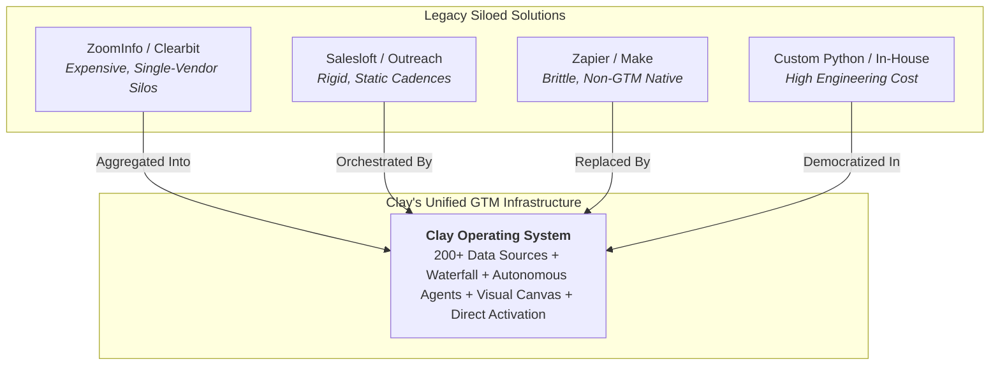
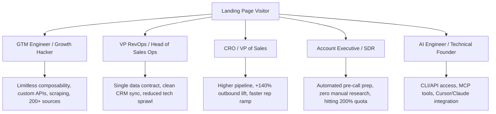
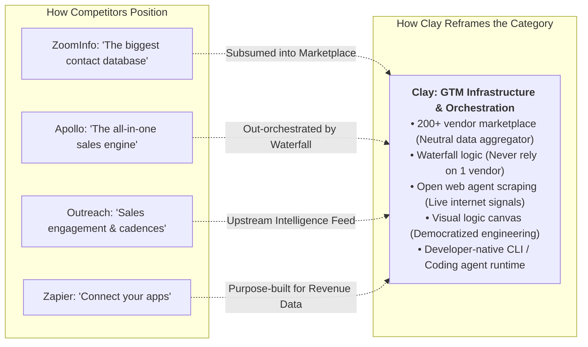
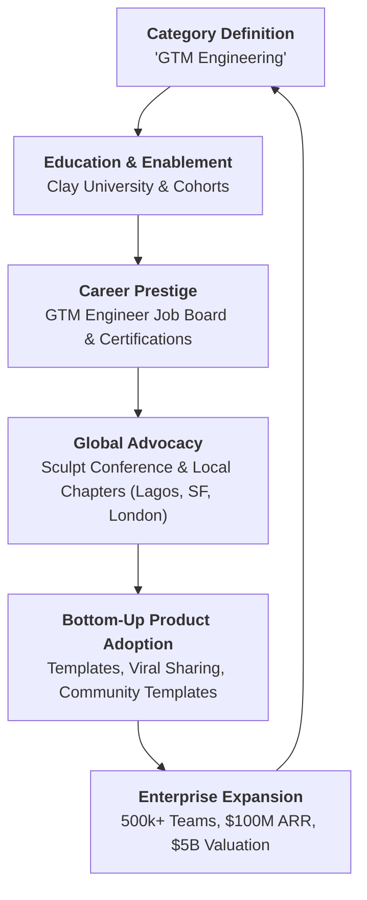
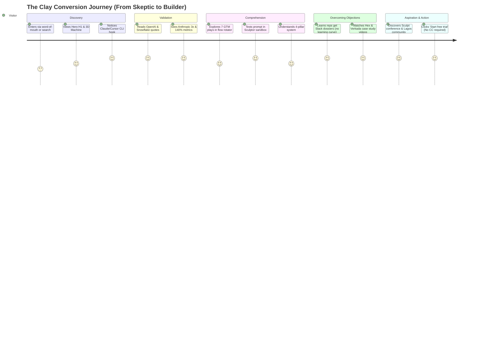

# Clay Landing Page Marketing Strategy Reverse Engineering Report

**Inspection Date**: November 2026  
**Auditor**: Senior Growth Marketing Strategist, B2B Positioning Expert, Creative Director, Customer Psychology Researcher & Conversion Strategist  
**Target URL**: `https://www.clay.com/`  
**Classification**: Comprehensive SaaS Reverse-Engineering & Strategic Conversion Audit  

---

## 1. Executive Summary

Clay (`clay.com`) represents one of the most sophisticated positioning and demand-generation evolutions in the history of modern B2B Go-to-Market (GTM) software. Initially launched as an experimental modular relational table, Clay has transformed into the foundational **"GTM Infrastructure & Orchestration Platform"** for the artificial intelligence era, commanding a \$5 Billion enterprise valuation and \$100M+ in ARR.

Where legacy players like ZoomInfo, Apollo, and Clearbit sell access to a closed, static database, and sales engagement platforms like Outreach or Salesloft automate rigid email cadences, Clay has executed a paradigm-shifting maneuver: **it has created a brand-new professional category—the "GTM Engineer"—and positioned itself as the developer-grade operating system that powers them.**

### Core Strategic Findings

1. **Category Transcendence ("Infrastructure, Not a Tool")**: Clay avoids the crowded, race-to-the-bottom "data provider" or "cold email sequencer" buckets. Instead, it positions itself alongside Snowflake, Salesforce, and developer tools: *"Salesforce for record-keeping, Snowflake for product data, and Clay for turning it all into automated action."*
2. **The "Data Marketplace & Waterfall" Moat**: Clay neutralizes data-quality skepticism by aggregating **200+ third-party data providers** (including Clearbit, Apollo, ZoomInfo, People Data Labs, Harmonic, PredictLeads) under a single contractual roof, running programmatic waterfall enrichment. If Vendor A lacks an email or mobile phone, the query cascades instantly to Vendor B, C, and D.
3. **Agentic Workflows Grounded in Internet Context**: Rather than offering generic generative AI chat boxes that hallucinate generic sales copy, Clay embeds **autonomous agents (Claygent & Account Agents)** capable of live web-scraping, parsing SEC 10-K filings, verifying tech stack badges, and scanning LinkedIn hiring spikes.
4. **Dual Developer-and-Operator Onboarding**: In a breakthrough conversion move, Clay bridges non-technical growth operators with technical builders. Alongside standard `Start free trial` and `Get a demo` CTAs, the hero embeds a 1-click **Coding Agent Plugin integration** for Claude, Cursor, and Windsurf (`https://github.com/clay-run/agent-plugins`), turning software developers and AI agents into bottom-up pipeline architects.
5. **A Movement-Driven Demand Generation Flywheel**: Clay’s conversion architecture does not rely solely on software trials. It is anchored in a global educational and human movement: **Clay University**, the annual **Sculpt Conference**, local community chapters spanning San Francisco to Lagos, Nigeria, and a certified **GTM Engineer job board and partner ecosystem**.

---

## 2. Business Positioning

### 2.1 What Product Clay Sells
Clay sells an **AI-powered GTM Orchestration and Data Infrastructure Engine**. Structurally, it combines four interconnected layers:
*   **Data Aggregation Layer**: A unified marketplace of 200+ external data providers and AI models accessed via a single credit pool and unified API/canvas.
*   **Enrichment & Waterfall Engine**: Multi-tiered cascading data retrieval that maximizes email coverage, verified mobile phone numbers, company revenue, and specialized technographics.
*   **Agentic Intelligence Layer**: Autonomous AI research agents (Claygent, Account Agents, Inbound SDR agents) that browse the open web, synthesize unstructured text, and interpret intent signals in real time.
*   **Orchestration & Visual Workflow Canvas**: A spreadsheet-meets-developer visual IDE allowing revenue teams to program complex GTM logic ("if/then" routing, lead scoring, programmatic 1:1 outbound copywriting, automated inbound response, and ad audience sync) with clicks, formulas, or raw code.

### 2.2 The Problem It Solves
Modern B2B revenue teams face **The Outbound Efficiency Collapse**:
1.  **Data Fragmentation**: Revenue teams subscribe to 5+ distinct data vendors (ZoomInfo for phones, Clearbit for firmographics, Apollo for emails, BuiltWith for tech stacks) paying multiple expensive six-figure annual contracts with low coverage overlap.
2.  **Stale, Static Data**: Traditional B2B contact lists decay at ~30% annually, causing high email bounce rates, domain burn, and wasted SDR hours.
3.  **Generic AI Fatigue**: Spray-and-pray automated sequencers pushing lazy "I saw you work at {Company}" messages have degraded cold outbound reply rates across the tech sector.
4.  **The RevOps Engineering Bottleneck**: Executing creative GTM plays previously required dedicated software engineers writing custom Python scrapers, managing webhook queues, or building fragile Zapier workflows.

### 2.3 Verified Positioning vs. Strategic Interpretation

| Dimension | Observable Evidence on Landing Page (Verified) | Strategic & Market Interpretation (Analysis) |
|---|---|---|
| **Category Name** | *"GTM Infrastructure"* / *"Infrastructure to get any data, run agentic workflows, and launch GTM plays."* | Moves Clay out of "SaaS sales tools" into core enterprise infrastructure (like Snowflake or Datadog), commanding higher multiples and defensive retention. |
| **Persona Champion** | *"GTM engineers build on Clay"* | Creates a new executive persona with technical prestige, separating Clay users from low-skill SDR "email blasters." |
| **Data Architecture** | *"One contract to buy data from 200+ data and AI vendors in Clay’s marketplace."* | Solves procurement hell; eliminates the need for buyers to negotiate multiple data vendor contracts. |
| **AI Role** | *"Put agents that know your business to work... turn context into research, scoring, and personalized outreach."* | Counters AI skepticism by demonstrating contextual, auditable research (10-K filings, SOC 2 compliance) rather than generic text generation. |
| **Workflow Paradigm** | *"Visual canvas... Use clicks, code, or chat with Clay to build GTM plays you can easily see."* | Democratizes engineering power for revenue operations, bridging the gap between no-code builders and software engineers. |
| **Integrations & MCP** | *"Paste in your coding agent... install directly with [Claude, Cursor, Copilot]"* | Embraces the agentic AI developer trend, making Clay the primary execution runtime for LLM coding environments. |

### 2.4 Competitive Framing & Alternatives



---

## 3. Target Audience & Customer Segmentation

Clay addresses multiple disparate buyer archetypes across the enterprise hierarchy without diluting its technical credibility:



### 3.1 Persona Profiles & Pain-Solution Matrix

1.  **The GTM Engineer / Growth Marketer (The Champion)**:
    *   *Psychological State*: Highly ambitious, frustrated by rigid tools like HubSpot or Outreach, wants to test creative signal-based outbound experiments.
    *   *Clay Resonance*: Clay validates their technical identity. The visual canvas and developer CLI treat them like software architects rather than spam distributors.
2.  **VP of Revenue Operations (The Evaluator)**:
    *   *Psychological State*: Overwhelmed by vendor renewals, CRM data pollution, and SDR complaints about incorrect phone numbers.
    *   *Clay Resonance*: One consolidated data invoice for 200+ providers; automated bidirectional CRM cleaning; auditable waterfall enrichment logic.
3.  **CRO / VP of Sales (The Economic Buyer)**:
    *   *Psychological State*: Terrified of declining SDR productivity, rising CAC, and wasted pipeline investments.
    *   *Clay Resonance*: Hard audited proof from OpenAI, Anthropic, Rippling, and Hex (+140% outbound pipeline, 50% increase in inbound win rates).
4.  **Sales Development Reps & AEs (The End-User)**:
    *   *Psychological State*: Spending 4+ hours daily manually researching prospects on LinkedIn, reading news, and pasting info into Salesforce.
    *   *Clay Resonance*: "Build systems that make reps more productive." Automated Slack dossiers, pre-call briefs, and 200% quota attainment (Pendo).
5.  **Technical Founders & AI Builders (The Early Adopter)**:
    *   *Psychological State*: Wanting programmatic outbound integrated with modern LLMs and agent frameworks.
    *   *Clay Resonance*: First-class CLI, GitHub plugin repository (`clay-run/agent-plugins`), and MCP support for Claude/Cursor.

---

## 4. Customer Pain Points

Clay deconstructs four layers of customer pain that have paralyzed traditional sales organizations:

```
┌─────────────────────────────────────────────────────────────────────────────┐
│                           THE B2B OUTBOUND CRISIS                           │
├───────────────────────────────┬─────────────────────────────────────────────┤
│ STRUCTURAL PAIN POINT         │ HOW CLAY ARTICULATES & RESOLVES IT          │
├───────────────────────────────┼─────────────────────────────────────────────┤
│ 1. Vendor Lock-In & Low Match │ "One contract to buy data from 200+ data and│
│    Rates (Single-Source Data) │ AI vendors." Cascades through providers to  │
│                               │ achieve 80%+ enrichment coverage.           │
├───────────────────────────────┼─────────────────────────────────────────────┤
│ 2. The Death of Generic Email │ "Write 1:1 messaging for every prospect     │
│    Blasts (Deliverability)    │ programmatically." Tailors copy to real live│
│                               │ company signals (10-Ks, hiring, tech stack).│
├───────────────────────────────┼─────────────────────────────────────────────┤
│ 3. Speed-to-Lead Lag          │ "Reducing speed-to-lead to <5 mins." Auto-  │
│    (Inbound Opportunity Loss) │ mates enrichment, qualification, and routing│
│                               │ for incoming demo requests instantly.       │
├───────────────────────────────┼─────────────────────────────────────────────┤
│ 4. Heavy Engineering Backlog  │ "Use clicks, code, or chat with Clay to     │
│    (RevOps Execution Drag)    │ build GTM plays you can easily see." Launch │
│                               │ complex data pipelines in hours, not weeks. │
└───────────────────────────────┴─────────────────────────────────────────────┘
```

---

## 5. Value Proposition Architecture

Clay organizes its value proposition around an asymmetric triad:

$$\text{Total GTM Velocity} = \text{Universal Data Access (200+ Sources)} \times \text{Autonomous AI Research} \times \text{Visual Orchestration Canvas}$$

*   **Primary Value Proposition**: *"Build systems to grow revenue. Infrastructure to get any data, run agentic workflows, and launch GTM plays."*
*   **Secondary Supporting Propositions**:
    *   *Data*: "Get data from the most complete data marketplace under one contract."
    *   *Intelligence*: "Put agents that know your business to work researching, scoring, and personalizing."
    *   *Orchestration*: "Build GTM plays on a visual canvas using clicks, code, or natural language."
    *   *Rep Enablement*: "Build systems that make reps more productive, hit 200% quota, and eliminate manual pre-call research."

---

## 6. Hero Strategy Analysis

```
┌─────────────────────────────────────────────────────────────────────────────┐
│                       CLAY HERO SECTION ARCHITECTURE                        │
├─────────────────────────────────────────────────────────────────────────────┤
│ [H1] Build systems to grow revenue                                          │
│                                                                             │
│ [Subhead] Infrastructure to get any data, run agentic workflows,            │
│           and launch GTM plays.                                             │
│                                                                             │
│ [Primary CTA Button] Start free trial  --> [Secondary CTA] Get a demo       │
│                                                                             │
│ [Developer Integration Hook]                                                │
│ or install directly with [Claude] [Cursor] [Copilot]                        │
│ └─> Popover: "Paste in your coding agent" | Copy: github.com/clay-run/...   │
│                                                                             │
│ [Hero Visual: Whimsical 3D Rube Goldberg Revenue Contraption]              │
│ Looping animation: Funnels, tubes, magnets, and balls operating on hills     │
└─────────────────────────────────────────────────────────────────────────────┘
```

### Detailed Evaluation of Key Questions

#### 1. How does Clay explain its product?
Clay explains its product as **"Infrastructure to get any data, run agentic workflows, and launch GTM plays."** Notice the intentional vocabulary:
*   *Infrastructure*: Connotes permanence, foundational utility, high reliability, and enterprise scale (contrasted with disposable point solutions).
*   *Any data*: Emphasizes universal aggregation over proprietary database limitations.
*   *Agentic workflows*: Positions Clay at the absolute technological frontier of autonomous reasoning.
*   *GTM plays*: Frames output around repeatable, strategic business actions rather than mechanical email blasts.

#### 2. How does it communicate its value?
By framing the ultimate outcome as **"systems to grow revenue."** Clay does not sell "emails", "leads", or "scraping credits." It sells an automated, deterministic revenue generation engine that runs continuously in the background.

#### 3. What makes its positioning distinctive?
Clay avoids the standard SaaS trap of showing a generic dashboard or a smiling sales rep wearing a headset. Instead, it positions itself as the **software engineering substrate for growth**. The inclusion of direct installation paths for **Claude, Cursor, and Windsurf** immediately signals to the visitor that Clay belongs in the developer tooling pantheon alongside Stripe, Supabase, and Vercel.

#### 4. What does the hero make the visitor curious about?
The whimsical **3D Rube Goldberg contraption** (funnels, floating magnetic tracks, rolling spheres, and pneumatic tubes set on rolling green hills) creates immense visual fascination. It metaphorically visualizes a complex, delightful mechanical system turning raw, messy inputs into elegant, predictable outputs. The visitor wonders: *"What is this machine? How does my go-to-market motion turn into this automated assembly line?"*

#### 5. How does the hero communicate product sophistication?
Through the subtle harmony between extreme developer power (coding agent CLI, GitHub repo, agentic orchestration) and frictionless accessibility (zero credit card sign-up, visual canvas, no-code tables). It communicates: *"This is powerful enough for software engineers, but intuitive enough for growth operators."*

#### 6. What customer problem is emphasized?
The hero emphasizes the problem of **system fragmentation and manual execution**. Revenue teams are exhausted from manually stitching together data providers and executing ad-hoc outreach; Clay provides the unifying infrastructure to run these motions systematically.

#### 7. What motivates the visitor to continue exploring?
The duality of the hero’s visual charm and architectural ambition compels the user to scroll down to see the real mechanical proof: *"How does OpenAI use this? Where does the 200+ provider data come from? What does the canvas look like?"*

---

## 7. Complete Landing Page Section Inventory

The live Clay homepage is engineered as an **11-stage psychological persuasion gauntlet**:

```
┌─────────────────────────────────────────────────────────────────────────────┐
│ 1. GLOBAL STICKY NAVIGATION BAR                                             │
│    Brand mark + Mega Menus (Product, Solutions, Resources, Company, Pricing)│
│    + ⌘K Search + Log in + Get a demo + Start free trial (High-contrast CTA) │
├─────────────────────────────────────────────────────────────────────────────┤
│ 2. HERO SECTION & CODING AGENT INTEGRATION                                  │
│    H1 + Subhead + Dual CTAs + CLI Code Agent Hook + 3D Contraption Visual   │
├─────────────────────────────────────────────────────────────────────────────┤
│ 3. ENTERPRISE SOCIAL PROOF & AUDITED ROI MARQUEE                            │
│    500k+ Teams + OpenAI / Snowflake Quotes + +140% Pipeline + 139 Logos     │
├─────────────────────────────────────────────────────────────────────────────┤
│ 4. "GTM ENGINEERS BUILD ON CLAY" (INTERACTIVE WORKFLOW ROTATOR)             │
│    7 Core Plays: TAM Sourcing, Inbound, Lead Scoring, Outbound, CRM, Ads... │
├─────────────────────────────────────────────────────────────────────────────┤
│ 5. "SCULPTOR" NATURAL LANGUAGE SANDBOX ("What do you want to build?")       │
│    Live interactive prompt input + looping examples + people/company chips  │
├─────────────────────────────────────────────────────────────────────────────┤
│ 6. THE 4-PILLAR ARCHITECTURE MODULES                                        │
│    [DATA: 200+ Vendors] -> [AGENTS: Contextual AI] ->                       │
│    [ORCHESTRATION: Visual Canvas] -> [ACTIVATION: Multi-channel Action]      │
├─────────────────────────────────────────────────────────────────────────────┤
│ 7. GTM INFRASTRUCTURE FOR SALES REP PRODUCTIVITY                            │
│    Automating pre-call research briefs + Slack dossiers + 200% Pendo Quota  │
├─────────────────────────────────────────────────────────────────────────────┤
│ 8. VIDEO CASE STUDY THEATER & ENTERPRISE EXPANSION PROOF                    │
│    Hex (+50% Inbound Win Rate) + Verkada (28 EMEA Country Expansion)        │
├─────────────────────────────────────────────────────────────────────────────┤
│ 9. THE GTM ENGINEERING MOVEMENT & GLOBAL COMMUNITY                          │
│    Sculpt 2026 Conference + Clay University + Livestreams + Lagos Story     │
├─────────────────────────────────────────────────────────────────────────────┤
│ 10. CLOSING HIGH-CONVERSION BANNER                                          │
│     "Turn your growth ideas into reality today" + Free trial + No CC        │
├─────────────────────────────────────────────────────────────────────────────┤
│ 11. ENTERPRISE FOOTER & VALUATION AUTHORITY                                 │
│     Category directories + $5B Valuation NYT note + Brooklyn heritage       │
└─────────────────────────────────────────────────────────────────────────────┘
```

---

## 8. Detailed Section-by-Section Marketing Analysis

### Section 1: Global Sticky Navigation Bar
*   **Marketing Purpose**: Provides persistent orientation, deep product taxonomy exploration via mega-menus, and an omnipresent zero-friction conversion escape hatch (`Start free trial` and `Get a demo`).
*   **Customer Attraction**: Clean, high-density typographic layout. Includes a keyboard shortcut (`⌘K`) signaling developer tool responsiveness and product polish.
*   **Customer Psychology**:
    *   *Mindset before*: Seeking orientation or looking for pricing/login.
    *   *Reaction*: Reassured by institutional breadth; impressed by menu depth (Data marketplace, Waterfall, Agents, Orchestration, Solutions by department).
    *   *Mindset after*: Perceives Clay as a serious, multifaceted platform rather than a simple Chrome extension.
*   **Persuasion Mechanisms**: Authority, accessibility, functional competence, persistent conversion readiness.

### Section 2: Hero Section & Coding Agent Integration
*   **Marketing Purpose**: Define the category ("GTM Infrastructure"), establish the core value thesis ("Build systems to grow revenue"), and convert both low-friction self-serve builders and enterprise buyers.
*   **Customer Attraction**: High-contrast typography paired with the whimsical 3D animated Rube Goldberg contraption. Direct terminal integration for Claude and Cursor.
*   **Customer Psychology**:
    *   *Mindset before*: "Is this just another lead scraper like Apollo or ZoomInfo?"
    *   *Reaction*: "No, this is an orchestration system. And I can install it directly into my coding agent."
    *   *Mindset after*: Intrigued, curious, categorized Clay as an engineering platform.
*   **Persuasion Mechanisms**: Category reframing, curiosity, technological prestige, low-friction activation.

### Section 3: Enterprise Social Proof & Audited ROI Wall
*   **Marketing Purpose**: Eradicate data-quality skepticism immediately following the hero. Validate that the world's most elite AI companies (OpenAI, Anthropic, Mistral) build their revenue motions on Clay.
*   **Customer Attraction**: Prominent quotes from tech titans:
    *   *OpenAI*: *"Clay has one of the most practical and exciting applications of AI, in a decades-old practice that has long been stale."*
    *   *Snowflake / Salesforce Orchestration*: *"Salesforce for record-keeping, Snowflake for product data, and Clay for turning it all into automated action."*
    *   Audited quantifiable callouts: `+140% OUTBOUND PIPELINE`, `80%+ ENRICHMENT COVERAGE`, `All inbound QUALIFIED AND SCORED WITH CLAY`, `3x'd our enrichment rate` (Anthropic).
*   **Customer Psychology**:
    *   *Mindset before*: "Everyone promises good data; in reality, half of it bounces."
    *   *Reaction*: "If OpenAI and Anthropic trust Clay to enrich their pipeline and research accounts, this isn't standard scraping software."
    *   *Mindset after*: High institutional trust; FOMO (Fear Of Missing Out).
*   **Persuasion Mechanisms**: Extreme authority, tier-1 social proof, hard audited metrics, competitive validation.

### Section 4: "GTM Engineers Build on Clay" (Interactive Flow Rotator)
*   **Marketing Purpose**: Move from abstract claims to concrete, tactical execution. Show exactly how real GTM plays are configured across 7 operational domains.
*   **Customer Attraction**: An interactive rotating showcase with actual UI screenshots, data tables, formula builders, and live email previews covering:
    1.  *TAM Sourcing*: Sourcing security engineering leaders across US/UK/Australia.
    2.  *Automated Inbound*: Auto-enriching demo forms and routing them in <5 mins.
    3.  *Lead Scoring*: Complex conditional scoring formulas based on PLG user spikes and hiring signals.
    4.  *Automated Outbound*: Detecting VP/Director promotions and triggering contextual congratulations.
    5.  *CRM Enrichment*: Bidirectional data hygiene and clean rooms.
    6.  *Launch Ads*: Programmatic ABM audience syncing to Meta, LinkedIn, and Google Ads.
    7.  *Rep Productivity*: AI-generated Slack briefs delivered before prospect meetings.
*   **Customer Psychology**:
    *   *Mindset before*: "How does this actually work day-to-day?"
    *   *Reaction*: "This solves my exact problem with demo response times and promotion tracking."
    *   *Mindset after*: High product comprehension; visual realization of ROI.
*   **Persuasion Mechanisms**: Product demonstration, use-case mapping, clarity, operational efficiency.

### Section 5: "Sculptor" Natural Language Sandbox ("What do you want to build?")
*   **Marketing Purpose**: Eliminate the "blank canvas anxiety" inherent in powerful modular tools. Let the visitor test their own query in natural language before signing up.
*   **Customer Attraction**: A live pulsing prompt box with cycling real-world queries:
    *   *"Find companies with 30+ sales reps, $10M+ in revenue, and a free trial button on their website"*
    *   *"Find companies with 3+ open roles that mention international expansion in the job descriptions"*
*   **Customer Psychology**:
    *   *Mindset before*: "This looks powerful, but it might take months to learn how to configure."
    *   *Reaction*: "I can just type what I want in plain English? It can look for a free trial button on their website?"
    *   *Mindset after*: Astonishment at the specificity of internet-scale intelligence; eager to hit `Submit`.
*   **Persuasion Mechanisms**: Interactive product demonstration, micro-commitment, curiosity hook, cognitive ease.

### Section 6: The 4-Pillar Architecture Modules (Data, Agents, Orchestration, Activation)
*   **Marketing Purpose**: Provide a clear mental model of the product's four foundational building blocks, each anchored by a tier-1 customer proof point:
    *   **DATA**: 200+ vendor marketplace under one contract (*Mistral AI cut TAM mapping from 2 months to 10 days*).
    *   **AGENTS**: Business-aware autonomous research (*OpenAI automated pre-call research; Vanta cut follow-up time from 3 days to <1*).
    *   **ORCHESTRATION**: Visual canvas with clicks, code, or chat (*Lovable booked 50% more qualified meetings; ElevenLabs +50% SQLs*).
    *   **ACTIVATION**: Programmatic 1:1 outbound across email and ads (*Rippling 2x cold email performance; Figma boosted PLG conversion*).
*   **Customer Attraction**: Clean structural cards combining feature breakdown with real case-study metrics and distinct exploration pathways.
*   **Customer Psychology**:
    *   *Mindset before*: Viewing Clay as a confusing collection of features.
    *   *Reaction*: Grasping the cohesive 4-step pipeline: *Gather Data $\rightarrow$ Deploy Agents $\rightarrow$ Orchestrate Logic $\rightarrow$ Activate Channels*.
    *   *Mindset after*: Total system clarity; buyer understands how Clay replaces multiple software invoices.
*   **Persuasion Mechanisms**: Conceptual clarity, structured logic, customer proof pairing, feature-to-benefit translation.

### Section 7: GTM Infrastructure for Rep Productivity
*   **Marketing Purpose**: Neutralize the critical objection from Sales Leadership: *"My sales reps will never log into another complicated database tool."*
*   **Customer Attraction**: Displays how Clay acts as a headless intelligence backend that pushes finished briefs directly to reps in **Slack** or CRM.
*   **Proof**: *Pendo reps hit 200% of quota using agents for account research, tailored messaging and pre-call prep.* *Terrapinn generated +19% revenue per rep and reduced CAC by 90%.*
*   **Customer Psychology**:
    *   *Mindset before*: "My SDRs are already overwhelmed with tools."
    *   *Reaction*: "Reps don't have to learn Clay; Clay does the research and drops the answer right into Slack before their call."
    *   *Mindset after*: Relieved of change-management fears; enthusiastic about rep leverage.
*   **Persuasion Mechanisms**: Objection dismantling, sales enablement framing, risk reduction.

### Section 8: Video Case Study Theater & Enterprise Expansion Proof
*   **Marketing Purpose**: Provide deep-dive narrative validation for enterprise evaluators who need verifiable corporate references before scheduling a demo.
*   **Customer Attraction**: High-production video case studies and dedicated stories:
    *   *Hex*: How Hex increased inbound win-rate by 50% using Clay.
    *   *Verkada*: How Verkada’s GTM team scaled outbound across 28 European nations.
*   **Customer Psychology**:
    *   *Mindset before*: "This works for 10-person YC startups, but can it scale to multi-national enterprise revenue teams?"
    *   *Reaction*: "Verkada used this to conquer 28 countries in Europe; Hex transformed their entire inbound motion."
    *   *Mindset after*: Enterprise de-risking achieved; readiness for sales conversation.
*   **Persuasion Mechanisms**: Narrative social proof, peer identification, executive validation.

### Section 9: The GTM Engineering Movement & Global Community
*   **Marketing Purpose**: Transform Clay from a software product into a **cultural movement and career accelerator**.
*   **Customer Attraction**: Highlighting the ecosystem:
    *   *Sculpt 2026 Conference*: Flagship industry gathering for GTM engineers.
    *   *Clay University & Cohort Classes*: Structured education turning non-technical SDRs into high-earning GTM Engineers.
    *   *Human Interest Stories*: *"Sandra has built the Clay community in Lagos"* and *"Where girls often choose between career or marriage, she carved her own path"* (Javeria Shah).
    *   *GTM Engineer Job Board*: Proving that knowing Clay creates employment opportunities.
*   **Customer Psychology**:
    *   *Mindset before*: Evaluating a software vendor.
    *   *Reaction*: "This isn't just software; this is a career discipline. If I master Clay, I become indispensable."
    *   *Mindset after*: Deep emotional affinity; personal career aspiration aligned with platform adoption.
*   **Persuasion Mechanisms**: Aspiration, belonging, status elevation, community proof, educational enablement.

### Section 10: Closing High-Conversion Banner
*   **Marketing Purpose**: Capture the visitor at the absolute peak of emotional conviction, offering a frictionless entry point.
*   **Customer Attraction**: Minimalist dark-mode container with bold headline: *"Turn your growth ideas into reality today. Start for free today. No credit card required."*
*   **Customer Psychology**:
    *   *Mindset before*: Convinced of value, considering bookmarking for later.
    *   *Reaction*: "There's no credit card required, and I can start testing right now."
    *   *Mindset after*: Clicks `Start free trial`.
*   **Persuasion Mechanisms**: Friction elimination, urgency, low risk.

### Section 11: Enterprise Footer & Valuation Authority
*   **Marketing Purpose**: Provide comprehensive directory navigation while quietly communicating institutional dominance.
*   **Customer Attraction**: Includes an understated note: *"Article – NY Times: Clay allows employees to sell shares at a $5b valuation."* And the grounded creative signature: *"Born in Brooklyn • Art by Hudson."*
*   **Customer Psychology**:
    *   *Mindset before*: Bottom of page.
    *   *Reaction*: "\$5 Billion valuation reported by the New York Times. Clay is here to stay."
    *   *Mindset after*: Zero concern about vendor stability or insolvency.
*   **Persuasion Mechanisms**: Institutional authority, financial stability, authentic brand heritage.

---

## 9. Differentiation Strategy

Clay’s landing page executes a masterclass in **Multi-Dimensional Competitive Differentiation**:



### 1. Category Creation ("GTM Engineering")
Clay does not compete for the title of "Best Lead Database" or "Best Email Tool." It coined and champions **GTM Engineering** as a formal technical discipline. By defining the job title, creating the curriculum (Clay University), hosting the conference (Sculpt), and operating the job board, Clay makes itself the sole platform on which this new discipline operates.

### 2. Category Reframing (Aggregator vs. Database)
Every traditional data vendor claims to have the cleanest database. Clay brilliantly sidesteps this unprovable debate by declaring: **No single vendor has all the data.** By becoming a neutral marketplace of 200+ vendors, Clay turns competitors like Clearbit, People Data Labs, and PredictLeads into its suppliers.

### 3. Workflow Differentiation (Spreadsheet Meets IDE)
Traditional enterprise software forces users into rigid forms and menus. Clay adopts the universal, familiar primitive of the **spreadsheet**, supercharged with API connectors, conditional logic columns, and autonomous agent loops. Users instantly feel they have infinite freedom to build whatever play they imagine.

### 4. Agentic Differentiation (Live Web Research vs. Text Generation)
Generic AI sales tools simply generate personalized sentences using OpenAI's API. Clay’s agents (**Claygent**) operate as research assistants: browsing websites, checking pricing pages for free trial buttons, scanning LinkedIn for open roles, reading 10-K filings, and checking SOC 2 trust centers. This creates high-signal data points that human SDRs could never collect at scale.

---

## 10. Product Storytelling & Complex Product Communication

A platform that combines 200+ APIs, code execution, web scrapers, and visual workflows risks overwhelming prospective buyers. Clay systematically overcomes this complexity:

### Detailed Answers to Core Communication Questions

#### 1. How does Clay reduce perceived complexity?
1.  **Familiar UI Metaphor**: By housing complex database queries and API calls inside familiar spreadsheet rows and columns.
2.  **The "Sculptor" Natural Language Interface**: Allowing visitors to express complex queries in conversational English (*"Find companies with 30+ reps and a free trial button"*), proving they do not need to write code to harness the engine.
3.  **Modular 4-Layer Framing**: Grouping hundreds of technical capabilities into four intuitive stages: **Data $\rightarrow$ Agents $\rightarrow$ Orchestration $\rightarrow$ Activation**.

#### 2. How does it turn technical features into customer benefits?
*   *Technical Feature*: Multi-provider API cascade $\rightarrow$ *Benefit*: **"80%+ Enrichment Coverage; never miss a lead's phone or email."**
*   *Technical Feature*: Headless web scraper $\rightarrow$ *Benefit*: **"Create intent signals from anything on the internet."**
*   *Technical Feature*: Asynchronous LLM batch processing $\rightarrow$ *Benefit*: **"Pendo reps hit 200% quota by eliminating pre-call manual research."**

#### 3. How does it demonstrate product value?
Through **audited enterprise micro-case studies embedded directly alongside capability descriptions**:
*   Anthropic 3x’d enrichment rates.
*   Mistral AI compressed TAM mapping from 2 months to 10 days.
*   Rippling doubled cold email performance.
*   ElevenLabs lifted SQLs by 50% via <5 min inbound speed-to-lead.

#### 4. How does it make the visitor understand the workflow?
The **interactive 7-tab workflow rotator** walks the visitor step-by-step through real operational screens: from setting up a filter, to viewing enriched rows, to previewing the tailored email draft, to triggering Slack alerts. The visitor sees the entire cause-and-effect chain.

#### 5. How does product visualization support the message?
Clay balances two distinct visual styles:
*   **Whimsical 3D Art (Hudson Art)**: The Rube Goldberg contraption conveys joyful creativity, making the complex process of revenue engineering feel fun and frictionless.
*   **High-Fidelity Real UI Snapshots**: Sharp, legible screenshots of actual formulas, table columns, and Slack webhooks ground the whimsical art in enterprise reality.

---

## 11. Customer Psychology & Cognitive Progression

Clay’s landing page engineers a deliberate sequence of psychological shifts:

```
[ Skepticism / Tool Fatigue ] 
   │  "Not another sales tool with bad data and generic AI spam."
   ▼
[ Cognitive Intrigue ] (Hero & Coding Agent Hook)
   │  "This is GTM infrastructure. Even coding agents can install it."
   ▼
[ Institutional De-risking ] (OpenAI / Anthropic Proof)
   │  "If OpenAI and Snowflake run on this, the data quality is real."
   ▼
[ Operational Awakening ] (7 Interactive GTM Plays)
   │  "I can automate demo response, promotion alerts, and lead tiers."
   ▼
[ Empowered Capability ] (Sculptor Sandbox)
   │  "I can build complex workflows in plain English in minutes."
   ▼
[ Emotional Aspiration & Belonging ] (Community & Lagos Story)
   │  "This platform transforms careers. I want to become a GTM Engineer."
   ▼
[ Frictionless Action ] (No-Credit-Card Sign-up)
   │  "I have everything to gain and zero risk by testing this right now."
```

---

## 12. Demand Generation Strategy

Clay’s demand generation engine is unique in B2B SaaS. It does not simply capture existing demand; it **manufactures new demand** through category-building:



1.  **The "GTM Engineer" Category Flywheel**: Clay recognized that SDRs were burning out and RevOps teams were bogged down. By elevating growth practitioners into "GTM Engineers," Clay offers individuals a path to career elevation and higher salaries. Those practitioners become vocal, lifelong brand evangelists.
2.  **Clay University & Live Livestreams**: By providing free, world-class education on modern outbound tactics ("How Clay Uses Clay"), Clay turns prospects into skilled builders before they ever pay a dollar.
3.  **The Sculpt Conference**: Clay establishes its own industry tentpole event, cementing its position as the intellectual center of gravity for modern B2B revenue operations.
4.  **Global Grassroots Community**: Highlighting grassroots champions in emerging tech hubs (e.g., Sandra in Lagos, Nigeria) gives the brand authentic human warmth and demonstrates that Clay's power is universal.

---

## 13. CTA and Conversion Architecture

### Comprehensive CTA Audit

| CTA Copy | Page Location | Visual Prominence | Action Destination | Funnel Type | CRO Friction Reducer |
|---|---|---|---|---|---|
| **Start free trial** | Sticky Nav (Right) | High-contrast Solid Pill | `app.clay.com/signup` | Self-serve PLG | Persistent across 100% of scroll depth |
| **Get a demo** | Sticky Nav (Right) | Secondary Ghost Button | `/demo` | Sales-Led Enterprise | Clear route for large buying teams |
| **Start free trial** | Hero Section | Primary Large Action Button | `app.clay.com/signup` | Self-serve PLG | Prominent arrow hover micro-interaction |
| **Get a demo** | Hero Section | Secondary Muted Button | `/demo` | Sales-Led Enterprise | Side-by-side alternative for enterprise leads |
| **Paste in your coding agent** | Hero CLI Tooltip | Interactive Copyable Box | `github.com/clay-run/...` | Developer / Builder | 1-click clipboard copy for Claude/Cursor |
| **Submit** (Arrow Button) | Sculptor Sandbox | High-Contrast Pulse Button | Product Query Handoff | Activated PLG | Natural language query carried into app |
| **Explore data marketplace** | Feature 1 (DATA) | Text Link with Icon | `/integrations` | Educational / Discovery | Lets skeptics verify data providers |
| **Explore agents** | Feature 2 (AGENTS) | Text Link with Icon | `/agent` | Educational / Discovery | In-depth agent architecture breakdown |
| **Explore visual workflows** | Feature 3 (ORCHESTRATION) | Text Link with Icon | `/workflows` | Educational / Discovery | Visual workflow canvas exploration |
| **Learn more about building plays** | Feature 4 (ACTIVATION) | Text Link with Icon | `university.clay.com` | Community / Education | Routes to Clay University courses |
| **Read case study** (Hex) | Customer Slider | High-Contrast Pill Link | `/customers/hex` | Enterprise Proof | Detailed audited ROI metrics |
| **Get tickets** (Sculpt) | Updates Section | Text Link with Arrow | `sculpt.clay.com` | Event Registration | Elevates brand to conference organizer |
| **Go to University** | Updates Section | Text Link with Arrow | `university.clay.com` | Education Activation | Free training reduces churn |
| **Start free trial** | Closing Section | Primary Solid Button | `app.clay.com/signup` | Bottom-of-Funnel Conversion | Accompanied by *"No credit card required"* |
| **Get a demo** | Closing Section | Secondary Outline Button | `/demo` | Enterprise Bottom-of-Funnel | Low-pressure enterprise route |

---

## 14. Conversion Journey Reconstruction



---

## 15. Trust Architecture & Objection Handling Matrix

```
┌─────────────────────────────────────────────────────────────────────────────┐
│                       OBJECTION HANDLING MATRIX                             │
├───────────────────────────────┬─────────────────────────────────────────────┤
│ CUSTOMER OBJECTION            │ CLAY'S EVIDENCE & ON-PAGE RESOLUTION        │
├───────────────────────────────┼─────────────────────────────────────────────┤
│ 1. "B2B data is always stale  │ • Aggregates 200+ providers in marketplace  │
│    and full of bad emails."   │ • Programmatic Waterfall Enrichment engine  │
│                               │ • Anthropic: 3x'd enrichment rate           │
├───────────────────────────────┼─────────────────────────────────────────────┤
│ 2. "AI outbound is generic    │ • Contextual agents browse the open web,    │
│    hallucinated spam."        │   10-K filings, and job boards live         │
│                               │ • OpenAI: Practical AI in a stale practice  │
├───────────────────────────────┼─────────────────────────────────────────────┤
│ 3. "Our sales reps won't adopt│ • Reps never need to log into Clay          │
│    another complex tool."     │ • AI agents push dossiers to Slack & CRM    │
│                               │ • Pendo: Reps hit 200% quota                │
├───────────────────────────────┼─────────────────────────────────────────────┤
│ 4. "Is Clay stable enough for │ • Trusted by 500,000+ teams                 │
│    enterprise revenue scale?" │ • Customers: OpenAI, Anthropic, Rippling    │
│                               │ • $5 Billion valuation reported in NY Times │
├───────────────────────────────┼─────────────────────────────────────────────┤
│ 5. "It looks too complex to   │ • Sculptor: Build plays in plain English    │
│    learn without engineers."  │ • Visual canvas with clicks, code, or chat  │
│                               │ • Free Clay University training & templates │
└───────────────────────────────┴─────────────────────────────────────────────┘
```

---

## 16. Narrative Architecture

Clay’s landing page layout is engineered around an escalating psychological logic:

$$\text{Categorize (Hero)} \longrightarrow \text{De-risk (Logos)} \longrightarrow \text{Demonstrate (Plays)} \longrightarrow \text{Engage (Sculptor)} \longrightarrow \text{Architect (4 Pillars)} \longrightarrow \text{Empower (Community)} \longrightarrow \text{Convert (Trial)}$$

1.  **Categorize & Intrigue**: The hero separates Clay from disposable sales tools, establishing it as core GTM infrastructure with coding agent support.
2.  **Immediate Credibility Shock**: Tier-1 logos and quotes (OpenAI, Snowflake, Anthropic) immediately neutralize skepticism before the visitor questions data accuracy.
3.  **Concrete Workflow Demonstration**: The 7 interactive flow tabs show actual UI mechanics, proving the system is real, practical, and versatile.
4.  **Active Engagement**: The Sculptor sandbox invites the visitor to touch the product mentally, lowering barriers to entry.
5.  **Systematic Deconstruction**: The 4-Pillar modules provide the rational architecture (Data, Agents, Orchestration, Activation) justifying the platform's power.
6.  **Human & Movement Elevation**: Community stories, Sculpt conference, and Clay University transform a software trial into a career milestone.
7.  **Frictionless Conversion**: The closing banner removes financial risk (*No credit card required*).

---

## 17. Strategic Strengths

1.  **Category Leadership via "GTM Engineering"**: Coining and owning the professional discipline provides insurmountable brand defensibility.
2.  **The Multi-Provider Neutral Marketplace**: By partnering with 200+ data vendors rather than competing with them, Clay avoids the data-quality blame game and provides unbeatable enrichment coverage.
3.  **Coding Agent & Developer Integration**: Embedding Claude/Cursor installation commands directly in the hero anticipates the future where AI agents build software pipelines autonomously.
4.  **Flawless Customer Proof Selection**: Featuring OpenAI, Anthropic, Mistral, and Snowflake creates an aura of unrivaled technical prestige.
5.  **Human Warmth in a Technical Domain**: Combining Hudson’s playful 3D contraptions with heartfelt global stories (Lagos, Nigeria) humanizes a data-heavy software platform.

---

## 18. Weaknesses & Optimization Opportunities

### Weaknesses (Empirical Evidence & Analytical Hypotheses)
1.  **Absence of Transparent Pricing Anchors on Homepage**: While "Pricing" exists in the sticky nav, the landing page copy does not clarify credit consumption mechanics, potentially intimidating budget-conscious SMB buyers.
2.  **Cognitive Load for Non-Technical Operators**: The density of concepts (CLI, APIs, Waterfall, Functions, Reverse ETL, Webhooks, Coding Agents) may cause traditional sales leaders to believe Clay requires full-time dedicated engineering talent.
3.  **In-Hero Interactive Execution**: While the Sculptor prompt is interactive, it does not display an immediate mock data table preview *on the homepage* before routing to sign-up.

### Optimization Opportunities
1.  **Inline Live Data Query Teaser**: Allow visitors who type a prompt in the Sculptor box to see a 3-row live sample preview directly on the homepage before requiring account creation.
2.  **Segmented "Solutions by Maturity" Toggle**: Offer a quick toggle in the hero (*"I am an SDR / RevOps Leader / Developer"*) to instantly personalize the primary visual and value metrics.
3.  **Explicit Credit Economics Reassurance**: Add a micro-copy badge near the hero CTA explaining: *"Free plan includes 100 free credits across all 200+ data providers."*

---

## 19. Key Lessons for Other B2B SaaS Companies

1.  **Don't Build Another Tool; Create a New Discipline**: When your market is commoditized, stop fighting over feature checklists. Define a new professional role (e.g., "GTM Engineer") and become the sole operating system that enables it.
2.  **Aggregate Rather than Compete**: If your competitors have proprietary data or siloed assets, build the marketplace that unifies them. The aggregator ultimately controls the customer relationship and workflow.
3.  **Ground Your AI in External Reality**: Move beyond generic text generation. Prove that your AI browses live websites, reads SEC filings, and checks technical badges to extract unique, auditable intelligence.
4.  **Embrace the Coding Agent Ecosystem**: Modern B2B software must be accessible not just to human clicks, but to AI agents running inside Cursor, Claude, and terminal CLIs.
5.  **Build a Career Ladder, Not Just Software**: Give your champions credentials, conferences, job boards, and community recognition. Software is bought with corporate budgets, but adopted through personal career aspirations.

---

## 20. Required Section Analysis Table

| Section | Strategic Objective | Customer Problem | Differentiation | Psychological Trigger | Visitor Mindset | Desired Outcome | Evidence |
|---|---|---|---|---|---|---|---|
| **1. Global Sticky Nav** | Provide persistent navigation and frictionless conversion access across all scroll depths. | Confusion over product scope, features, and pricing access. | High-density mega-menus; ⌘K command shortcut; direct CLI and demo pathways. | Accessibility & Professional Polish | "What else does this company offer? How much does it cost?" | Clicks `Start free trial`, `Get a demo`, or navigates to solutions. | Sticky nav with 5 mega-menus, ⌘K search, and high-contrast buttons. |
| **2. Hero Section** | Establish category leadership as "GTM Infrastructure" and convert self-serve & enterprise builders. | Fragmented data tools, rigid cadences, and manual sales prospecting. | Positions as foundational infrastructure; embeds coding agent CLI hook (Claude/Cursor). | Curiosity, Modernity, Innovation | "Is this another ZoomInfo or Apollo clone?" | Understands it's an orchestration platform; clicks trial or inspects CLI. | H1: "Build systems to grow revenue"; 3D Rube Goldberg contraption; CLI install hook. |
| **3. Enterprise Social Proof Wall** | Eradicate data-quality skepticism immediately through tier-1 customer authority. | Skepticism regarding bounced emails, stale databases, and fake AI claims. | Audited proof from OpenAI, Anthropic, Snowflake; +140% pipeline metrics. | Extreme Authority & Social Validation | "Does this actually work, or is it just marketing hype?" | Reassured that the world's best AI companies rely on Clay. | OpenAI quote; Snowflake orchestration quote; 139 customer logos; +140% outbound stat. |
| **4. GTM Flow Rotator** | Demonstrate tangible execution across 7 core operational revenue plays. | Inability to visualize how abstract "orchestration" applies to daily sales tasks. | Shows full-stack workflow: filters, enriched tables, lead scores, auto-drafted emails. | Product Demonstration & Cognitive Clarity | "What does building on Clay actually look like in practice?" | Connects their specific pain (e.g., inbound lag) to a live Clay workflow. | 7 tabs (TAM, Inbound, Lead Scoring, Outbound, CRM, Ads, Reps) with real UI tables. |
| **5. Sculptor Prompt Sandbox** | Eliminate blank-canvas anxiety and engage visitors in interactive co-creation. | Feeling intimidated by complex workflow builders or technical query builders. | Natural language prompt interface that translates conversational English into GTM plays. | Micro-commitment & Interactive Curiosity | "Can this system find the exact niche accounts I care about?" | Types a prompt or clicks a preset chip to trigger account creation. | Textarea with pulsing border; examples: "30+ reps, $10M+ rev, free trial button on site". |
| **6. The 4-Pillar Architecture** | Provide a structured mental framework of the platform (Data, Agents, Orchestration, Activation). | Tool sprawl; paying 5+ separate subscriptions for scraping, AI, and cadences. | 200+ vendor marketplace; autonomous research agents; visual canvas; multi-tool activation. | Conceptual Simplicity & Structural Logic | "What are the core components of this platform?" | Realizes Clay consolidates data, intelligence, and execution into one contract. | 4 cards with eyebrows: DATA, AGENTS, ORCHESTRATION, ACTIVATION + customer quotes. |
| **7. Rep Productivity Module** | Overcome sales leadership resistance regarding rep onboarding and software fatigue. | Sales reps refusing to adopt complex software; hours wasted on manual pre-call prep. | Headless delivery: AI agents push dossiers and briefs directly into Slack and CRM. | Objection Reduction & Operational Leverage | "My reps already struggle with Salesforce; they won't use this." | Convinced that reps gain leverage without having to learn complex UI. | Eyebrow: GTM INFRASTRUCTURE; Pendo quote (200% quota); Slack brief UI mockup. |
| **8. Video Case Studies** | Provide deep enterprise reference proof for VPs, CROs, and RevOps evaluators. | Fear of adopting a tool that won't scale across international enterprise teams. | High-production video case studies showcasing measurable business transformation. | Institutional De-risking & Peer Empathy | "Has a scaled enterprise successfully deployed this across teams?" | Watches Hex (+50% win-rate) or Verkada (28 EMEA countries) case studies. | Video player container; Hex 50% win rate lift; Verkada 28-country expansion story. |
| **9. GTM Engineering Movement** | Cultivate a loyal developer-style movement and career advancement flywheel. | Feeling trapped in low-leverage SDR or manual ops roles with limited career growth. | Clay University, Sculpt conference, community chapters, and dedicated job board. | Aspiration, Belonging & Career Advancement | "This is more than software; it's a high-paying career path." | Enrolls in Clay University, gets tickets to Sculpt, or joins the Slack community. | Sculpt 2026 conference card; Lagos community feature; University links; Job board. |
| **10. Closing Banner** | Maximize bottom-of-page conversion velocity with zero financial risk. | Procrastination; fear of complicated procurement or hidden credit card charges. | Direct invitation to build immediately; explicit zero-friction guarantee. | Urgency & Risk Elimination | "I've seen enough; let me try building a play right now." | Clicks `Start free trial` or `Get a demo`. | H2: "Turn your growth ideas into reality today"; "No credit card required" copy. |
| **11. Enterprise Footer** | Anchor institutional stability, platform depth, and long-term viability. | Fear of startup vendor instability, data privacy non-compliance, or bankruptcy. | Highlights \$5B valuation via NY Times article, extensive product taxonomy, Brooklyn roots. | Institutional Authority & Trust | "Is this company going to be around in 5 years?" | Retains lasting brand impression of enterprise-scale solidity. | Link: "NY Times: Clay allows employees to sell shares at a $5b valuation"; full taxonomy. |

---
*Report autonomously generated following live DOM inspection, reverse-engineering, and strategic analysis of `https://www.clay.com/`.*
