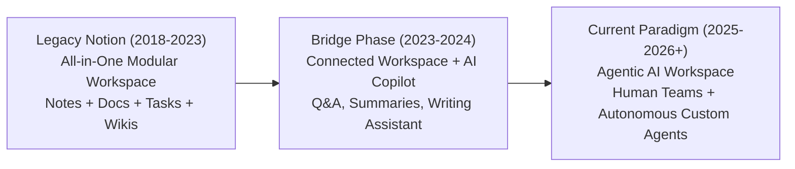
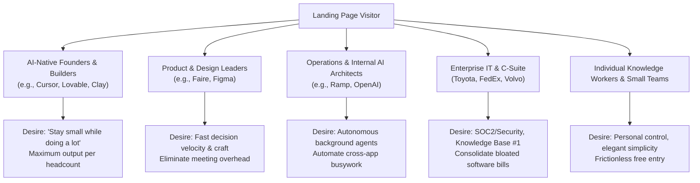
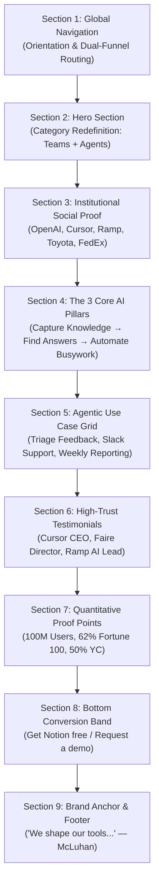
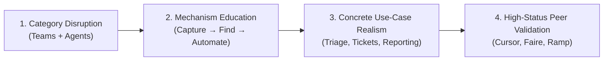
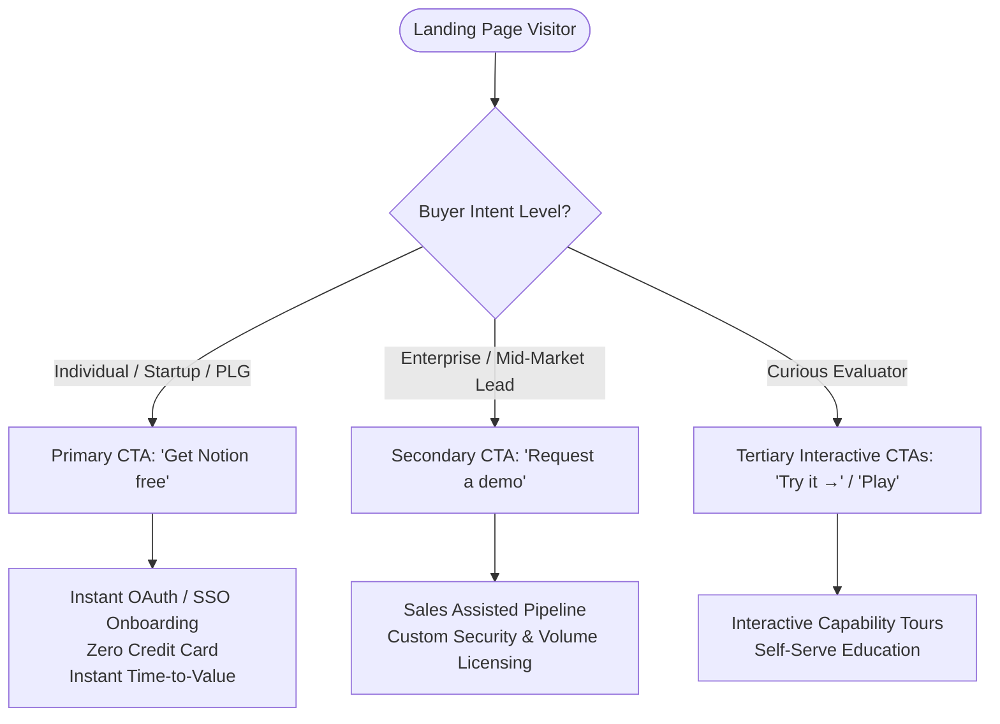
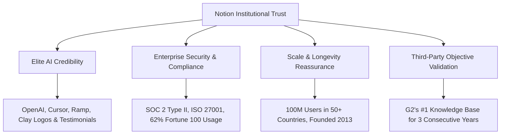

# Notion Landing Page Marketing Strategy Reverse Engineering Report

**Inspection Date**: November 2026  
**Auditors**: Senior Brand Strategist, Product Marketing Strategist, Customer Psychology Researcher, UX Researcher & SaaS Growth Strategist  
**Target URL**: `https://www.notion.com/`  
**Classification**: Comprehensive SaaS Reverse-Engineering & Behavioral Conversion Audit  

---

## 1. Executive Summary

Notion’s current homepage represents one of the most consequential strategic pivots in modern enterprise software. Historically known as the beloved "all-in-one workspace" for notes, wikis, and project databases, Notion has systematically repositioned itself as **"The AI workspace where teams and agents think, ship, and build together."**

Rather than treating Artificial Intelligence as an ancillary feature (a chat sidebar, generative copy assistant, or summarization widget), Notion has elevated AI into an autonomous workforce participant—an **"Agent"** that lives directly inside the company’s system of record. The homepage is meticulously architected to bridge the profound chasm between human knowledge workers and autonomous software agents.



### Strategic Key Findings
1. **Category Elevation from "Note App" to "Agentic Operating System"**: Notion avoids competing in the commoditized note-taking or wiki categories. By centering the hero headline around **"Where teams and agents Think / Ship / Build / Jam together,"** it stakes an early claim on the future of work: hybrid human-agent teams.
2. **The 3-Step Functional Flywheel**: Notion deconstructs an inherently complex product into three non-negotiable operational steps: **Capture Knowledge** (System of Record) $\rightarrow$ **Find Answers** (Enterprise AI Search with Citations) $\rightarrow$ **Automate Busywork** (24/7 Custom Agents).
3. **Dual-Funnel Conversion Architecture**: The page seamlessly balances frictionless Product-Led Growth (instant zero-friction signup via `"Get Notion free"`) with enterprise de-risking and pipeline generation (`"Request a demo"`).
4. **Prestige and De-risking Social Proof**: By showcasing AI pioneers (**OpenAI, Cursor, Ramp, Clay, Lovable**) alongside Fortune 500 stalwarts (**Toyota, FedEx, Lamborghini, Volvo, L'Oreal**) and cultural icons (**A24, Substack, David Zwirner**), Notion achieves an unprecedented triple-threat halo: cutting-edge AI credibility, enterprise compliance security, and aesthetic craft.
5. **Philosophical Brand Moat**: Concluding with Marshall McLuhan’s timeless aphorism—*"We shape our tools, and thereafter our tools shape us"*—Notion elevates itself beyond transactional SaaS software into an indispensable intellectual instrument.

---

## 2. Brand Positioning

### 2.1 What Does Notion Sell?
At the software layer, Notion sells a unified, modular productivity workspace combining docs, wikis, relational databases, AI search, and autonomous workflow automations. 

At the strategic and psychological layer, Notion sells **organizational clarity and workforce leverage**. It sells the ability for companies to operate with the agility of a 10-person startup while maintaining the institutional memory and rigor of a Fortune 500 enterprise.

### 2.2 Category Redefinition: The "AI Workspace"
Notion explicitly avoids positioning itself against point solutions:
- It is not just a document editor (vs. Google Docs / Word).
- It is not just an internal knowledge base (vs. Confluence).
- It is not just a task board (vs. Trello / Asana / Monday).
- It is not just an AI chat tool (vs. standalone ChatGPT / Perplexity).

Instead, Notion defines a proprietary category: **The System of Record for Human and Agent Collaboration**.

| Dimension | Legacy Productivity Suite (Google / Microsoft) | Dedicated Point Solutions (Confluence, Asana) | Generic AI Assistants (Standalone LLM Chatbots) | Notion (Agentic AI Workspace) |
|---|---|---|---|---|
| **Architecture** | Siloed apps (Docs separated from Sheets, Tasks, and Chat) | Rigid, purpose-built databases with high friction | Ephemeral chat windows without workspace context | Modular canvas: text, data, and logic coexist seamlessly |
| **System of Record** | Fractured across Google Drive / OneDrive folders | Static documentation siloed away from daily execution | None; user must manually supply prompt context | Unified single source of truth for all company knowledge |
| **Search & Retrieval** | Primitive keyword search yielding lists of unread files | Keyword match with broken permission indexing | Hallucinatory or restricted to public internet data | Instant answers grounded in company docs with source citations |
| **Workforce Model** | Human-only labor assisted by basic spellcheck/formatting | Human-only task assignment and tracking | Human prompts AI; AI responds; human copies text | **Hybrid Teams**: Humans and 24/7 Custom Agents working side-by-side |

### 2.3 The Core Positioning Equation
$$\text{Notion Value} = \frac{\text{Institutional Knowledge} \times \text{Autonomous Agent Execution}}{\text{Tool Fragmentaton} + \text{Context Switching Friction}}$$

### 2.4 What Notion Wants Visitors to Believe
1. *"Work is hopelessly fragmented across too many disconnected tools, causing burnout and lost context."*
2. *"Generic AI chatbots don't work because they lack the context of our company's daily work."*
3. *"AI is only truly useful when it lives directly inside our documents, databases, and tasks."*
4. *"If our team uses Notion, we don't just work faster—we deploy autonomous agents that do work for us 24/7."*
5. *"The most ambitious and innovative companies in the world already run their entire businesses on Notion."*

---

## 3. Target Audience & Customer Segmentation

Notion serves a notoriously wide demographic, ranging from individual college students to multi-thousand-person enterprises. The homepage solves this multi-persona challenge through modular, role-targeted value framing:



### Detailed Persona Breakdown

| Persona | Primary JTBD (Job-to-be-Done) | Acute Pain Point Addressed | Key Page Hook / Proof Point | Conversion Pathway |
|---|---|---|---|---|
| **High-Growth Startup Founder** | Scale business output without bloating headcount | Hiring is expensive; coordination overhead kills momentum | Michael Truell (CEO Cursor) testimonial: *"stay small while doing a lot"* | Primary CTA: `"Get Notion free"` |
| **Product & Design Manager** | Turn customer feedback and specs into shipped software | Feedback is scattered across Slack, tickets, and emails | Use case: *"Triage product feedback"* + Renee Solorzano (Faire) quote | Product interactive tour |
| **Operations & AI Lead** | Automate internal operational workflows and support | Endless repetitive questions in Slack; manual reporting | Ben Levick (Ramp) testimonial + *"Automate busywork: Custom Agents"* | Demo request / Feature exploration |
| **Enterprise IT / CISO** | Secure institutional knowledge and consolidate software spend | Shadow IT, unverified AI models leaking IP, fragmented wikis | *"62% of Fortune 100"*, *"G2 #1 Knowledge Base"*, Enterprise logo wall | Secondary CTA: `"Request a demo"` |
| **Individual Knowledge Worker** | Organize personal tasks, meeting notes, and knowledge | Chaotic desktop, scattered notes, mental overwhelm | Visual elegance, clean white space, instant PLG onboarding | Primary CTA: `"Get Notion free"` |

---

## 4. Customer Problems & Frustrations

The Notion homepage diagnoses five pervasive pathologies of modern knowledge work:

### 4.1 The "Scavenger Hunt" Syndrome (Knowledge Fragmentation)
- **Frustration**: Employees spend an estimated 20–30% of their working hours searching for information across Google Docs, Slack threads, Jira tickets, and email chains.
- **Notion Diagnosis**: Knowledge is fragmented; nobody knows what is canonical or up-to-date.
- **The Page Answer**: *"Bring everything into one system of record."*

### 4.2 The "Chatbot Hallucination & Context Void" Problem
- **Frustration**: Standalone AI tools (like ChatGPT or generic web copilots) know everything about world history, but zero about the project spec finalized in yesterday's design review.
- **Notion Diagnosis**: AI without organizational context produces generic, unusable hallucinated text.
- **The Page Answer**: *"Capture context, find answers... with AI built for your team"* + *"Get answers, instantly—with citations."*

### 4.3 The "Infinite Busywork" Loop
- **Frustration**: Highly paid engineers, product managers, and operators spend hours triaging support tickets, summarizing weekly project status, and routing feedback.
- **Notion Diagnosis**: Manual busywork stifles creative leverage and strategic focus.
- **The Page Answer**: *"Keep work moving 24/7 with agents"* + *"Automate busywork."*

### 4.4 Tool Fatigue and Subscription Bloat
- **Frustration**: Teams are suffocated by managing 6+ subscriptions: one for docs, one for wikis, one for roadmaps, one for AI chat, one for search.
- **Notion Diagnosis**: Disconnected point solutions create friction, data silos, and massive software expenditure.
- **The Page Answer**: A singular, beautifully designed workspace that replaces point solutions natively.

---

## 5. Value Proposition

### Primary Value Proposition
> **"Capture context, find answers, and automate tasks with AI built for your team."**

### Decomposition of the Value Proposition
1. **"Capture context" (The Ingestion Layer)**: Notion serves as the durable foundation. It does not just store text; it preserves relational context, team ownership, project states, and metadata.
2. **"Find answers" (The Intelligence Layer)**: Transforming static documentation into an active oracle. Knowledge is instantly retrievable with verifiable source citations, removing human search friction.
3. **"Automate tasks with AI" (The Execution Layer)**: Moving beyond passive storage into proactive execution. Notion’s agents monitor changes, execute multi-step logic, and resolve workflows autonomously.
4. **"Built for your team" (The Collaborative Boundary)**: Clarifying that this is enterprise-grade, team-oriented AI with strict permission boundaries—not an isolated individual consumer gadget.

---

## 6. Hero Section Strategy

The hero section of Notion's landing page is an engineering masterpiece of cognitive simplicity and aspirational attraction.

```
┌────────────────────────────────────────────────────────────────────────────────────────┐
│  [Nav: Product | Resources | Pricing | Request a demo | Log in | Get Notion free]      │
├────────────────────────────────────────────────────────────────────────────────────────┤
│                                                                                        │
│               Where teams and agents  [ Think ▾ ]  together.                           │
│                                                                                        │
│        Capture context, find answers, and automate tasks with AI built for your team.  │
│                                                                                        │
│              [ Get Notion free ]        [ Request a demo ]                             │
│                                                                                        │
│     ┌───────────────────────────────────────────────────────────────────────────┐      │
│     │                                [ ▶ Play ]                                 │      │
│     │                                                                           │      │
│     │               CENTRAL VIDEO CANVAS & WORKSPACE DEMONSTRATION              │      │
│     │      (Dynamic interactions: Docs, Databases, AI Prompts & Agent Actions)  │      │
│     │                                                                           │      │
│     │   [ Floating Card 1 ]       [ Floating Card 2 ]     [ Floating Card 3 ]   │      │
│     └───────────────────────────────────────────────────────────────────────────┘      │
│                                                                                        │
│                       The most ambitious companies run on Notion.                      │
│        [OpenAI]   [A24]   [Figma]   [FedEx]   [Ramp]   [Cursor]   [Nvidia]   ...       │
└────────────────────────────────────────────────────────────────────────────────────────┘
```

### Analysis of the 6 Core Hero Questions

#### 1. How does Notion communicate a complex product simply?
Notion accomplishes this by using an **action-oriented modular verb structure**. Instead of listing technical features (relational databases, markdown editors, vector embeddings, LLM orchestration, webhook listeners), Notion summarizes the entire human-software relationship into one rotating dynamic pill:
- *"Where teams and agents **Think** together."*
- *"Where teams and agents **Ship** together."*
- *"Where teams and agents **Build** together."*
- *"Where teams and agents **Jam** together."*

These four verbs encompass the entirety of product creation. The visitor does not need to understand database schemas; they immediately grasp that Notion is where their work gets done.

#### 2. How does the hero make the product understandable?
The supporting copy uses a clean three-beat parallel cadence:
$$\text{Capture context} \longrightarrow \text{Find answers} \longrightarrow \text{Automate tasks}$$
This maps directly to human mental models:
- First, I write down what I know (**Capture**).
- Second, I search for what I need (**Find**).
- Third, I get rid of repetitive chores (**Automate**).
By reducing hundreds of software capabilities into a 3-stage logical progression, cognitive load is reduced to near zero.

#### 3. What customer desire does the headline target?
The headline targets the modern knowledge worker's burning desire for **technological leverage without alienation**.
In 2025–2026, professionals fear being replaced by AI or overwhelmed by disconnected AI novelties. Notion’s headline positions AI as a collaborative partner: *"Where teams and agents think together."* It taps into the aspirational vision of being an empowered "super-worker" who commands a fleet of intelligent agents inside their daily workspace.

#### 4. How does the visual help explain the product?
The hero visual is not a static screenshot or abstract 3D artwork. It is a live-rendered workspace canvas accompanied by a video demo and layered interactive cards (`pile_1.webp` through `pile_7.webp`):
- It displays real Notion blocks: a product roadmap table, a technical spec document, an inline AI prompt box, and an agent status indicator.
- The visual metaphor of "piles" represents the organized unification of chaotic work: messy loose notes and scattered data collapsing cleanly into structured Notion pages.
- The prominent `"Play"` button allows high-intent visitors to inspect the dynamic fluid interactions of Notion AI in action without leaving the homepage.

#### 5. Why might the CTA be effective?
The CTA pairing leverages an asymmetric psychological choice architecture:
- **Primary CTA: `"Get Notion free"`**: Removes all risk and transactional friction. No credit card required. Free forever tier. It promises immediate gratification—the visitor can start organizing their life in under thirty seconds.
- **Secondary CTA: `"Request a demo"`**: Caters directly to enterprise buyers (procurement officers, directors, CIOs) who are culturally conditioned to reject self-serve software that lacks SOC2 reviews, custom billing, and enterprise SLAs.

#### 6. What makes the visitor want to explore more?
The rotating pill animation creates micro-novelty in the hero headline, catching the eye. Below the video, the eyebrow text—*"The most ambitious companies run on Notion"*—followed immediately by the logos of OpenAI, Cursor, Figma, and Ramp, triggers an intense social comparison reflex: *"If the smartest AI engineering teams in Silicon Valley run their companies on this, what are we missing?"*

---

## 7. Complete Section Inventory

The live Notion homepage is architected into **9 strategic structural sections**:

| Section # | Component / Title | Dominant Element Type | Primary Content / Headline | Marketing Objective |
|---|---|---|---|---|
| **01** | Global Navigation Bar | Persistent Header | Logo, Product, Resources, Pricing, Demo, Log in, CTA | Frictionless orientation, app re-entry, enterprise sales routing |
| **02** | Hero Section | Dynamic Typography & Video Canvas | *"Where teams and agents Think together."* | Value proposition declaration, category redefinition, dual PLG/Sales CTA |
| **03** | Institutional Social Proof Marquee | Logo Wall / Ticker (23 Logos) | *"The most ambitious companies run on Notion."* | Elite social proof, technological validation, enterprise security de-risking |
| **04** | Core 3-Pillar Architecture | Modular Feature Articles (3 Cards) | *"AI where your team works."* (Capture, Find, Automate) | Functional education; explaining how Notion solves data silos & busywork |
| **05** | Agentic Use Case Showcase | Departmental Workflow Grid (5 Cards) | *"See what Notion can do"* (Triage, Support, Alerts, Reporting, Dev Tools) | Concrete utility demonstration; bridging the imagination gap for specific roles |
| **06** | Elite Customer Testimonial Showcase | High-Trust Case Study Cards (3 Profiles) | *"Trusted by teams that ship."* (Cursor CEO, Faire Design Dir, Ramp Ops Lead) | Peer-to-peer enterprise validation; auditable ROI and operational leverage |
| **07** | Quantitative Scale & Authority Stats | Auditable Metric Marquee (5 Milestones) | G2 #1, 100M users, 50% YC, 1.4M community, 62% Fortune 100 | Irrefutable quantitative proof; eliminating institutional adoption fear |
| **08** | Bottom Conversion Band | Dedicated Conversion Block | *"Get started today."* + Dual CTAs | Closing the conversion loop; capturing final intent at maximum conviction |
| **09** | Philosophical Brand Anchor & Global Footer | Cultural Artifact & Taxonomy Tree | McLuhan Quote: *"We shape our tools..."* + Global directory | Brand elevation; intellectual moat; multi-persona navigation & localization |

---

## 8. Section-by-Section Marketing Analysis



---

### SECTION 1: GLOBAL STICKY NAVIGATION BAR

```
┌────────────────────────────────────────────────────────────────────────────────────────┐
│ [N] Notion    Product ▾   Resources ▾   Pricing   Request a demo    Log in  [Get Notion free] │
└────────────────────────────────────────────────────────────────────────────────────────┘
```

#### 1. What is being communicated?
The header communicates clarity, transparency, and dual accessibility. The menu items (`Product`, `Resources`, `Pricing`, `Request a demo`) indicate that Notion is both an accessible everyday tool and a serious enterprise platform with transparent economics.

#### 2. Why is it being communicated?
Visitors to SaaS homepages experience immediate orientation anxiety: *"Is this for me? How much does it cost? Can I try it without talking to a pushy salesperson?"* The nav answers all three questions within 0.5 seconds of page load.

#### 3. Why is it positioned here?
As a persistent sticky header, it anchors the visitor throughout their scroll journey, ensuring that conversion options are perpetually within one click of visual attention.

#### 4. What attracts the visitor?
The clean, uncluttered layout and Notion's iconic black-and-white monogram logo. There are no garish promo banners or countdown timers; the aesthetic restraint communicates institutional confidence.

#### 5. What visitor belief does it influence?
It establishes the belief that Notion is an established, dependable utility. The presence of a clear `"Pricing"` link signals that pricing is fair and self-discoverable, dispelling fears of hidden enterprise gouging.

#### 6. What emotion or aspiration does it target?
**Sense of control and psychological safety**. The visitor feels unpressured and in complete command of their exploration.

#### 7. What does the visitor understand afterward?
They understand how to navigate the site, that they can sign up for free immediately, and that enterprise assistance is available if they represent an organization.

#### 8. How does it contribute to conversion?
It provides the primary persistent conversion endpoint (`"Get Notion free"`), capturing early converters who already decided to sign up before landing on the page.

---

### SECTION 2: HERO SECTION ("Where teams and agents Think together.")

```
┌────────────────────────────────────────────────────────────────────────────────────────┐
│                     Where teams and agents  [ Think ▾ ]  together.                     │
│        Capture context, find answers, and automate tasks with AI built for your team.  │
│                     [ Get Notion free ]        [ Request a demo ]                      │
│                            [ Central Interactive Video Canvas ]                        │
└────────────────────────────────────────────────────────────────────────────────────────┘
```

#### 1. What is being communicated?
Notion is where humans and AI agents unify to perform meaningful knowledge work. AI is not an external chatbot; it is a collaborative team member embedded in the workspace.

#### 2. Why is it being communicated?
To leapfrog every legacy competitor (Google Docs, Confluence, Microsoft 365) and avoid being labeled a commodity documentation tool. Notion is planting its flag at the absolute frontier of modern technology: agentic workflows.

#### 3. Why is it positioned here?
The hero is the first 5 seconds of the visitor experience. It must immediately disrupt outdated assumptions about what Notion is.

#### 4. What attracts the visitor?
- The dynamic, smooth rotating pill animation cycling through pastel colors and action verbs (*Think, Ship, Build, Jam*).
- The prominent central video canvas showing the elegant, responsive UI in action.

#### 5. What visitor belief does it influence?
It destroys the belief that Notion is "just a note-taking app for students" or "a personal to-do list." It replaces it with the belief that Notion is the most advanced collaborative operating system available.

#### 6. What emotion or aspiration does it target?
**Aspiration for superhuman productivity and cutting-edge status**. The visitor wants to be the forward-thinking professional who orchestrates intelligent agents rather than drowning in manual tasks.

#### 7. What does the visitor understand afterward?
They understand that Notion handles context capture, Q&A search, and workflow automation in a single unified canvas.

#### 8. How does it contribute to conversion?
It presents the primary zero-friction CTA (`"Get Notion free"`), capturing top-of-funnel PLG signups right at the peak of initial visual excitement.

---

### SECTION 3: INSTITUTIONAL SOCIAL PROOF & LOGO MARQUEE

```
┌────────────────────────────────────────────────────────────────────────────────────────┐
│                      The most ambitious companies run on Notion.                       │
│  [OpenAI]  [A24]  [Figma]  [FedEx]  [Ramp]  [Cursor]  [Toyota]  [Lamborghini]  ...      │
└────────────────────────────────────────────────────────────────────────────────────────┘
```

#### 1. What is being communicated?
Notion is trusted and relied upon by the world’s most admired companies, across technology, entertainment, manufacturing, and global commerce.

#### 2. Why is it being communicated?
Social proof is the ultimate antidote to buyer skepticism. When a visitor sees that OpenAI—the creators of the modern AI revolution—runs their company on Notion, any doubt regarding Notion's AI credentials dissolves immediately.

#### 3. Why is it positioned here?
Immediately beneath the bold hero claim. After making an audacious statement (*"Where teams and agents think together"*), Notion immediately provides proof that the world's most sophisticated companies already agree.

#### 4. What attracts the visitor?
The sheer density of elite cultural and technological brand marks:
- **AI Frontier**: OpenAI, Cursor, Ramp, Clay, Lovable
- **Fortune 500 Giants**: FedEx, Toyota, Lamborghini, Volvo, L'Oreal
- **Design & Culture**: A24, Figma, Substack, David Zwirner

#### 5. What visitor belief does it influence?
It shifts belief from *"This sounds like marketing hype"* to *"This is an industry standard adopted by organizations far smarter and larger than mine."*

#### 6. What emotion or aspiration does it target?
**Belonging and tribal validation**. Visitors want their own company to be counted among "the most ambitious."

#### 7. What does the visitor understand afterward?
Notion scales seamlessly from small hyper-agile AI startups to global industrial enterprises with tens of thousands of employees.

#### 8. How does it contribute to conversion?
It dismantles the risk objection for enterprise evaluators, making the upcoming feature exploration feel credible and vetted.

---

### SECTION 4: CORE 3-PILLAR VALUE ARCHITECTURE ("AI where your team works.")

```
┌────────────────────────────────────────────────────────────────────────────────────────┐
│                              AI where your team works.                                 │
│                                                                                        │
│  ┌────────────────────────┐  ┌────────────────────────┐  ┌──────────────────────────┐  │
│  │   Capture knowledge    │  │      Find answers      │  │    Automate busywork     │  │
│  │ Bring everything into  │  │ Get answers, instantly │  │ Keep work moving 24/7    │  │
│  │ one system of record.  │  │    —with citations.    │  │       with agents.       │  │
│  │       [Try it →]       │  │       [Try it →]       │  │        [Try it →]        │  │
│  └────────────────────────┘  └────────────────────────┘  └──────────────────────────┘  │
└────────────────────────────────────────────────────────────────────────────────────────┘
```

#### 1. What is being communicated?
The three operational mechanisms of the platform:
1. **Capture**: Centralize documentation, wikis, and project data into a single source of truth.
2. **Find**: Instant semantic AI search across all internal knowledge that returns synthesized answers with clickable source citations.
3. **Automate**: Deploy custom AI agents that work asynchronously 24/7 to move projects forward without human intervention.

#### 2. Why is it being communicated?
To transform Notion from an abstract concept into an actionable mental workflow. Visitors need to know *what the software actually does on an average Tuesday morning*.

#### 3. Why is it positioned here?
Having established credibility in Section 3, Notion now systematically explains the product's architecture before drilling into specific use cases.

#### 4. What attracts the visitor?
High-fidelity visual UI cards showcasing real document layouts, search dialogues, and agent configurations with high aesthetic polish.

#### 5. What visitor belief does it influence?
It dismantles the belief that AI search produces hallucinations. The explicit emphasis on **"—with citations"** addresses the #1 enterprise objection to generative AI: unverified information.

#### 6. What emotion or aspiration does it target?
**Relief from chaos and anxiety**. The sensation of walking into a pristine, impeccably organized workspace where answers are never lost and routine work takes care of itself.

#### 7. What does the visitor understand afterward?
They understand the exact three-part mechanism: *My team writes in Notion $\rightarrow$ AI indexes and answers questions from Notion $\rightarrow$ Agents automate tasks in Notion.*

#### 8. How does it contribute to conversion?
Each card features a dedicated micro-CTA (`"Try it →"`), funneling high-interest visitors into specialized feature deep-dives and registration flows.

---

### SECTION 5: INTERACTIVE AGENTIC USE CASE SHOWCASE ("See what Notion can do")

```
┌────────────────────────────────────────────────────────────────────────────────────────┐
│                               See what Notion can do                                   │
│                                                                                        │
│  [ Triage product feedback → ]          [ Resolve support tickets in Slack → ]         │
│  [ Respond to security alerts faster → ][ Automate weekly reporting → ]                │
│  [ Create your own developer tools → ]                                                 │
└────────────────────────────────────────────────────────────────────────────────────────┘
```

#### 1. What is being communicated?
Tangible, departmental applications of Notion AI and Custom Agents across Product, Customer Support, Engineering, Operations, and Leadership.

#### 2. Why is it being communicated?
To bridge the **"Imagination Gap."** Most buyers understand that AI is powerful in theory, but struggle to conceive how it applies to their specific daily workflow.

#### 3. Why is it positioned here?
Immediately after explaining the high-level 3-pillar framework. It transitions the narrative from *architectural theory* to *departmental execution*.

#### 4. What attracts the visitor?
Highly specific, recognizable problem statements formatted as actionable cards. Every title addresses a known organizational headache.

#### 5. What visitor belief does it influence?
It dispels the belief that Notion is only for note-taking. Seeing *"Resolve support tickets in Slack"* and *"Respond to security alerts faster"* establishes Notion as a technical workflow engine.

#### 6. What emotion or aspiration does it target?
**Professional empowerment and efficiency**. The thrill of realizing: *"I can automate the worst 3 hours of my Friday afternoon."*

#### 7. What does the visitor understand afterward?
They realize that Notion integrates directly with their existing stack (Slack, code repositories, customer feedback channels) and actively executes work across those tools.

#### 8. How does it contribute to conversion?
Role-based targeting: a Product Manager clicks *"Triage product feedback"*, a Support Lead clicks *"Resolve support tickets in Slack"*, and an Engineering Director clicks *"Respond to security alerts faster"*, driving qualified traffic into specialized conversion sub-funnels.

---

### SECTION 6: HIGH-TRUST CUSTOMER TESTIMONIAL SHOWCASE ("Trusted by teams that ship.")

```
┌────────────────────────────────────────────────────────────────────────────────────────┐
│                            Trusted by teams that ship.                                 │
│                                                                                        │
│  ┌─────────────────────────┐ ┌─────────────────────────┐ ┌──────────────────────────┐ │
│  │       CURSOR CEO        │ │     FAIRE DESIGN DIR    │ │      RAMP AI LEAD        │ │
│  │ "Using the most         │ │ "Notion’s thoughtful    │ │ "Notion Custom Agents    │ │
│  │ AI-native tools like    │ │ design speeds up        │ │ help our team go beyond  │ │
│  │ Notion is an important  │ │ collaboration and       │ │ doing work with AI to    │ │
│  │ competitive advantage   │ │ decisions so we can     │ │ building AI tools that   │ │
│  │ for us to stay small    │ │ deliver impact to our   │ │ do the work for them."   │ │
│  │ while doing a lot."     │ │ customers faster."      │ │                          │ │
│  │ Michael Truell, CEO     │ │ Renee Solorzano, Des Dir│ │ Ben Levick, Ops & AI     │ │
│  └─────────────────────────┘ └─────────────────────────┘ └──────────────────────────┘ │
└────────────────────────────────────────────────────────────────────────────────────────┘
```

#### 1. What is being communicated?
Respected leaders at top-tier modern enterprises publicly testify to the direct competitive advantage Notion provides their organizations.

#### 2. Why is it being communicated?
Feature descriptions tell; customer stories sell. Buyers trust the unvarnished words of their peers far more than vendor marketing copy.

#### 3. Why is it positioned here?
After presenting features and use cases, the visitor naturally asks: *"Does this actually work in production at scale?"* This section delivers definitive proof.

#### 4. What attracts the visitor?
Authentic photographic portraits of genuine industry icons:
- Michael Truell (CEO of Cursor—the undisputed leader in AI coding)
- Renee Solorzano (Design Director at Faire)
- Ben Levick (Operations & AI Lead at fintech unicorn Ramp)

#### 5. What visitor belief does it influence?
It creates the belief that adopting Notion is not an expense, but a **strategic competitive advantage** that enables teams to stay lean, move fast, and outperform competitors.

#### 6. What emotion or aspiration does it target?
**Fear of Missing Out (FOMO) and competitive ambition**. If your competitors are using Notion to stay small while generating 10x output, sticking with legacy tools feels like organizational suicide.

#### 7. What does the visitor understand afterward?
They understand that real companies are not just using Notion for documentation—they are using Notion Custom Agents to replace human manual labor and accelerate decision cycles.

#### 8. How does it contribute to conversion?
It acts as the final peer-validation nudge, pushing skeptical mid-market and enterprise evaluators across the conversion threshold.

---

### SECTION 7: QUANTITATIVE PROOF POINTS & GLOBAL ADOPTION MARQUEE

```
┌────────────────────────────────────────────────────────────────────────────────────────┐
│  G2’s #1 knowledge base for 3 consecutive years   │   100M users in over 50 countries  │
│  Over 50% of YC companies   │   1.4M+ community   │   62% of Fortune 100 use Notion    │
└────────────────────────────────────────────────────────────────────────────────────────┘
```

#### 1. What is being communicated?
Massive, indisputable market dominance validated by independent third parties, global adoption figures, and startup/enterprise penetration rates.

#### 2. Why is it being communicated?
To eliminate all lingering "longevity risk" or "niche product" objections.

#### 3. Why is it positioned here?
Positioned right before the final conversion band. It provides the final statistical proof required by corporate committee members to justify a purchase decision.

#### 4. What attracts the visitor?
Bold, auditable milestone metrics:
- **G2's #1 Knowledge Base for 3 consecutive years** (Third-party peer rating)
- **100M users across 50+ countries** (Massive global reliability)
- **Over 50% of YC companies** (Silicon Valley startup consensus)
- **1.4M+ community members** (Grassroots ecosystem strength)
- **62% of the Fortune 100** (Enterprise security and scalability)

#### 5. What visitor belief does it influence?
It establishes the classic IBM maxim: *"Nobody ever got fired for buying Notion."* If 62% of the Fortune 100 and half of Y Combinator use it, it is the safest enterprise choice possible.

#### 6. What emotion or aspiration does it target?
**Total psychological reassurance and certainty**. The buyer feels confident that Notion will not shut down, lose their data, or fail security review.

#### 7. What does the visitor understand afterward?
They realize Notion is not an experimental app; it is one of the largest, most validated software platforms on earth.

#### 8. How does it contribute to conversion?
It provides the rational justification needed to support the emotional desire created throughout the earlier sections.

---

### SECTION 8: BOTTOM CONVERSION BAND ("Get started today.")

```
┌────────────────────────────────────────────────────────────────────────────────────────┐
│                                  Get started today.                                    │
│                     [ Get Notion free ]        [ Request a demo ]                      │
└────────────────────────────────────────────────────────────────────────────────────────┘
```

#### 1. What is being communicated?
A direct, friction-free invitation to begin using Notion immediately.

#### 2. Why is it being communicated?
Every effective landing page must culminate in an unambiguous call to action after building maximum desire and trust.

#### 3. Why is it positioned here?
At the logical termination of the narrative journey. The visitor has absorbed the positioning, features, use cases, testimonials, and scale metrics; now is the moment of commitment.

#### 4. What attracts the visitor?
Total visual simplicity. The page strips away all distractions, leaving only two high-contrast buttons against a clean background.

#### 5. What visitor belief does it influence?
The belief that getting started is trivial, instantaneous, and zero-risk.

#### 6. What emotion or aspiration does it target?
**Excitement and readiness to build**. The visitor is ready to clean up their workflow and start exploring.

#### 7. What does the visitor understand afterward?
They understand the two immediate options: dive into the product for free right now, or speak with an enterprise specialist.

#### 8. How does it contribute to conversion?
It acts as the primary bottom-of-page conversion capture point, harvesting all visitors who scrolled through the narrative.

---

### SECTION 9: PHILOSOPHICAL BRAND ANCHOR & GLOBAL FOOTER

```
┌────────────────────────────────────────────────────────────────────────────────────────┐
│  "We shape our tools, and thereafter our tools shape us." — Marshall McLuhan           │
│                                                                                        │
│  Product          Resources         Company         Notion for         [Language ▾]    │
│  Features         Customer stories  About us        Enterprise         English (US)    │
│  What's New       Connections       Careers         Small businesses   Cookie settings │
│  Notion AI        Marketplace       Security        Startups                           │
│  Pricing          Help Center       Status          Developers                         │
│  Download         Academy           Terms & privacy © 2026 Notion Labs                 │
└────────────────────────────────────────────────────────────────────────────────────────┘
```

#### 1. What is being communicated?
Notion’s philosophical soul and deep respect for human craftsmanship, alongside a comprehensive directory of the entire platform ecosystem.

#### 2. Why is it being communicated?
To leave a lasting intellectual impression. Notion does not want to be viewed as disposable software; it wants to be viewed as an era-defining medium for human thought.

#### 3. Why is it positioned here?
At the very base of the page, acting as the structural foundation and final punctuation mark of the brand story.

#### 4. What attracts the visitor?
The profound McLuhan quote: *"We shape our tools, and thereafter our tools shape us."* In an industry saturated with shallow marketing buzzwords, intellectual gravitas stands out dramatically.

#### 5. What visitor belief does it influence?
It reinforces the belief that Notion Labs is staffed by thoughtful, long-term designers and thinkers who care about the craftsmanship of software.

#### 6. What emotion or aspiration does it target?
**Intellectual respect and creative pride**. Users feel that using Notion makes them better thinkers and more intentional creators.

#### 7. What does the visitor understand afterward?
They understand the vast breadth of the Notion ecosystem (Academy, Marketplace, Community, Security, Developers, Templates) and feel part of a global cultural movement.

#### 8. How does it contribute to conversion?
Provides secondary exploration avenues for visitors who weren't ready for a direct signup, letting them self-educate via customer stories, security documentation, or the template marketplace.

---

## 9. Product Storytelling Strategy

Notion employs a **Demonstration-Led, Hybrid Framework** that seamlessly blends four distinct storytelling models:



### 1. Mechanism-First Deconstruction
Instead of overwhelming visitors with Notion's infinite sandbox capabilities, the storytelling enforces strict cognitive scaffolding:
- **Phase 1: Ingest Context**: You can't have intelligence without data. Notion establishes that knowledge must first be captured.
- **Phase 2: Instant Retrieval**: Once captured, knowledge is weaponized via search with verified citations.
- **Phase 3: Autonomous Action**: Once searchable, knowledge is executed upon by 24/7 background agents.

### 2. Departmental Micro-Narratives
In Section 5, Notion stops talking to the "generic visitor" and tells five hyper-specific mini-stories:
- *For the PM*: The story of transforming hundreds of noisy user feedback pings into categorized, prioritized product roadmaps without manual sorting.
- *For the Support Lead*: The story of an agent living inside Slack, resolving routine tier-1 questions by querying Notion wikis automatically.
- *For the Ops Leader*: The story of automated Monday morning executive reports compiled across disparate department boards while the team sleeps.

---

## 10. Emotional Positioning

Modern B2B landing pages often fail because they appeal strictly to rational ROI spreadsheets while ignoring the visitor's underlying emotional turmoil. Notion's emotional positioning targets five core psychological drivers:

```mermaid
quadrantChart
    title Emotional Positioning Matrix
    x-axis Low Stress --> High Stress
    y-axis Low Agency --> High Agency
    quadrant-1 Empowered & Agile (Notion Promised State)
    quadrant-2 Overwhelmed & Chaos (Legacy Baseline)
    quadrant-3 Resigned Apathy (Bloated Tool Stasis)
    quadrant-4 Focused Mastery (Individual Flow)
    "Legacy Tool Sprawl": [0.85, 0.25]
    "Chatbot Hallucination Anxiety": [0.75, 0.35]
    "Notion Agentic Collaboration": [0.25, 0.88]
    "Aesthetic Calm & Clarity": [0.15, 0.78]
```

### The Emotional Transformation Journey
1. **From Chaos to Cleanliness**: The transition from messy tabs, lost documents, and broken links to an elegant, whitespace-rich workspace creates a profound feeling of **aesthetic relief and calm**.
2. **From Imposter Syndrome to AI Mastery**: Rather than feeling intimidated by complex AI engineering, the visitor is made to feel like an effortless commander of custom agents.
3. **From Headcount Bloat to Lean Dominance**: Inspired by Cursor’s quote (*"stay small while doing a lot"*), founders feel the empowering thrill of running an elite, high-margin, small team that punches far above its weight class.

---

## 11. Aspirational Messaging

Notion systematically aligns its product capabilities with five universal professional aspirations:

### 1. The Aspiration to "Stay Small While Doing a Lot"
- **Customer Frustration**: Modern tech companies are crushed by hiring costs, coordination drag, and middle-management overhead.
- **Aspirational Promise**: Extreme operational leverage. A 10-person company can operate with the output of a 100-person firm.
- **Landing Page Proof**: Michael Truell (Cursor CEO) quote explicitly highlighting this exact phrase.
- **Product Backing**: Autonomous Custom Agents executing background workflows 24/7.

### 2. The Aspiration for Aesthetic Craft and Taste
- **Customer Frustration**: Enterprise software is traditionally ugly, clunky, and demoralizing to use (e.g., Jira, ServiceNow, legacy SharePoint).
- **Aspirational Promise**: Software as an art form. Work that feels elegant, mindful, and expressive.
- **Landing Page Proof**: Renee Solorzano (Faire Design Director) quote on *"Notion’s thoughtful design speeds up collaboration."*
- **Product Backing**: Flawless typographic hierarchy, minimalist monochrome aesthetic, drag-and-drop block physics.

### 3. The Aspiration for Intellectual Order and Truth
- **Customer Frustration**: The anxiety that company policies, specs, and architectural decisions are contradictory, buried, or forgotten.
- **Aspirational Promise**: One canonical, unshakeable System of Record.
- **Landing Page Proof**: *"Bring everything into one system of record"* and *"Get answers, instantly—with citations."*
- **Product Backing**: Centralized workspace search with direct source breadcrumb verification.

---

## 12. Customer Psychology & Cognitive Architecture

Notion’s landing page systematically triggers and manages known cognitive biases:

| Psychological Trigger / Bias | Implementation on Live Notion Homepage | Cognitive Effect on Buyer |
|---|---|---|
| **Social Proof / In-Group Bias** | Logos of OpenAI, Cursor, Ramp, Figma, Toyota, Lamborghini | *"The best in the world use this; if I don't, our company falls behind."* |
| **Cognitive Scaffolding** | 3-step value structure: Capture $\rightarrow$ Find $\rightarrow$ Automate | Reduces perceived product complexity; makes an infinite sandbox feel structured. |
| **Halo Effect** | Elegant typography, generous whitespace, Marshall McLuhan quote | Premium visual craft causes visitors to perceive the underlying code and AI as superior. |
| **Authority Bias** | "G2’s #1 Knowledge Base for 3 consecutive years" | Replaces subjective marketing claims with independent industry validation. |
| **Loss Aversion / FOMO** | Cursor: *"stay small while doing a lot"*; Ramp: *"building AI tools that do the work for them"* | Fear that competing startups with agents will outpace companies reliant on manual labor. |
| **Zero-Price Effect (Free PLG)** | Prominent, persistent `"Get Notion free"` CTAs with no credit card required | Eradicates financial friction; encourages immediate impulse adoption. |

---

## 13. Narrative Architecture & Customer Journey Map

The page follows a rigorous psychological progression, moving the visitor from initial hook to absolute conviction:

| Stage | Visitor Mindset | Marketing Message | Landing Page Section | Intended Psychological Effect |
|---|---|---|---|---|
| **1. Hook & Disruption** | *"I thought Notion was just a note app... what's new here?"* | *"Where teams and agents Think together."* | Hero Section (H1 + Video) | Captures curiosity; shatters outdated perceptions of product scope. |
| **2. Social Validation** | *"Is this real or just flashy marketing buzzwords?"* | *"The most ambitious companies run on Notion."* | Elite Logo Marquee (OpenAI, Cursor, FedEx) | Rapid de-risking; triggers prestige halo and competitive envy. |
| **3. Functional Scaffolding** | *"Okay, but how does it actually work in practice?"* | *"Capture context, find answers, automate busywork."* | 3 Core Value Pillars (Articles 1-3) | Cognitive clarity; visitor constructs a simple 3-step mental model of the product. |
| **4. Role Personalization** | *"Does this apply to my team's specific headaches?"* | *"See what Notion can do: feedback, support, reports."* | Agentic Use Case Grid (5 Workflows) | Personal relevance; visitor projects their own daily tasks onto the software. |
| **5. Peer Authority** | *"Are credible teams seeing real measurable results?"* | *"Trusted by teams that ship."* | Executive Testimonials (Cursor, Faire, Ramp) | Deep trust; proof that agents deliver actual operational leverage. |
| **6. Enterprise De-risking** | *"Is this secure, proven, and built to scale?"* | *"100M users, 62% Fortune 100, G2 #1."* | Quantitative Authority Metrics | Eradicates enterprise procurement and security anxiety. |
| **7. Frictionless Action** | *"I want to try this right now."* | *"Get started today."* | Final Dual Conversion Band | Zero-friction conversion; visitor signs up or books enterprise demo. |
| **8. Intellectual Moat** | *"This company represents something deeper."* | *"We shape our tools, thereafter our tools shape us."* | Footer & McLuhan Quote | Emotional reverence and lasting brand loyalty. |

---

## 14. CTA Strategy & Conversion Funnel Analysis



### Analysis of CTA Placement and Wording
1. **Primary Button Wording: `"Get Notion free"`**:
   - The word *"Get"* is active, possessive, and immediate.
   - The word *"free"* dissolves economic hesitation.
   - It contrasts sharply with weak, generic CTA copy like *"Submit"*, *"Sign Up"*, or *"Learn More"*.
2. **Secondary Button Wording: `"Request a demo"`**:
   - Clear, standard terminology for B2B enterprise procurement.
   - Positioned alongside the free button, ensuring that enterprise leads are never forced into self-serve onboarding if they require high-touch sales consultation.
3. **Repetition Cadence**:
   - Navigation: Persistent top-right corner.
   - Hero: High-contrast primary placement.
   - Feature Pillars: Contextual micro-actions (`"Try it →"`).
   - Bottom Band: Large-scale terminal conversion block.

---

## 15. Conversion Journey & Friction Minimization

Notion engineers an exceptionally frictionless path from impression to product activation:

### 1. Friction Reductions
- **Zero Financial Friction**: No credit card required at signup.
- **Zero Information Asymmetry**: Pricing is transparently linked directly in the global navigation.
- **Instant Identity Verification**: One-click Google and Apple OAuth on the `/signup` destination page.
- **Dynamic Session Awareness**: If a returning user visits `notion.com`, the nav dynamically adapts, showing `"Open Notion"` and `"Skip this page next time?"`, prioritizing product re-entry over redundant marketing pitches.

### 2. Dual-Engine Growth Mechanics
$$\text{Total Growth} = \underbrace{\text{PLG Self-Serve Velocity}}_{\text{100M Users / Free Tier}} + \underbrace{\text{Sales-Led Enterprise Expansion}}_{\text{62\% of Fortune 100 / Demo Requests}}$$

---

## 16. Trust Strategy & Institutional De-risking

To win enterprise deals against entrenched giants like Microsoft and Google, Notion establishes trust across multiple dimensions:



### Trust Architecture Breakdown
1. **The "OpenAI Halo"**: Showcasing OpenAI prominently in the logo wall is the single most potent trust signal in the modern AI economy. If the creators of the underlying frontier LLMs use Notion to organize their own team, Notion's architecture is self-evidently validated.
2. **Third-Party Quantitative Validation**: G2’s #1 Knowledge Base badge removes subjective bias. It is not Notion claiming to be the best; it is thousands of verified business reviews confirming it.
3. **Enterprise Defense**: Highlighting that 62% of the Fortune 100 runs on Notion reassures conservative enterprise risk committees that Notion complies with stringent data governance, encryption, and privacy requirements.

---

## 17. Strategic Strengths

1. **Visionary Category Framing**: Elevating the conversation from "where you take notes" to "where teams and agents work together" captures the defining technological shift of our generation.
2. **Extreme Cognitive Simplicity**: Managing to explain docs, wikis, relational databases, AI search, and autonomous agents in three clean verbs (*Capture, Find, Automate*).
3. **Flawless Design Craft & Taste**: The landing page embodies the exact aesthetic refinement promised by the software. There is zero visual dissonance between marketing and product reality.
4. **Unmatched Social Proof Spectrum**: Achieving equal credibility with hyper-agile Y Combinator startups and conservative Fortune 100 global conglomerates.
5. **Philosophical Depth**: The McLuhan footer quote gives Notion cultural longevity, turning software users into brand evangelists.

---

## 18. Strategic Vulnerabilities & Weaknesses

While the page is masterfully executed, a senior growth audit reveals several subtle strategic trade-offs:

1. **Potential Alienation of Non-Technical / Non-AI Users**: By placing such overwhelming emphasis on "AI Agents", Notion risks alienating traditional personal users (students, writers, small shop owners) who loved Notion for simple note-taking and feel alienated by corporate "agentic automation."
2. **The "Blank Canvas" Paradox**: Notion is notoriously open-ended. The homepage shows sleek glimpses of finished workspaces, but does not fully resolve the new user's anxiety: *"How much time will it take me to build this from scratch?"*
3. **Ambiguity of Custom Agents**: The page promises "Custom Agents that work 24/7", but does not deeply explain the technical barrier to configuring them. If non-technical users attempt to build an agent and encounter prompt engineering friction, churn could follow.
4. **Lack of Inline Pricing Transparency**: While `"Pricing"` is in the nav, the homepage body does not contain an inline pricing comparison table, forcing price-sensitive buyers to leave the narrative flow to inspect costs.

---

## 19. Actionable Lessons for B2B SaaS Landing Pages

Every SaaS founder and product marketing leader can extract 10 foundational principles from Notion's landing page:

1. **Name the Emerging Shift**: Don't position against yesterday's categories. Notion didn't call itself a "better wiki"; it positioned itself as the collaboration space for *teams and agents*.
2. **Reduce Complexity to a 3-Beat Rhythm**: If your product does 50 things, find the underlying 3-step flywheel (e.g., *Capture $\rightarrow$ Find $\rightarrow$ Automate*). Never overwhelm visitors with feature laundry lists.
3. **Curate Social Proof by Archetype**: Don't just display random logos. Segment your social proof into distinct pillars: (1) Technical Frontier Leaders, (2) Global Enterprise Giants, and (3) Creative/Design Icons.
4. **Anchor Abstract AI in Concrete Verifiable Utility**: Avoid vague promises like "Boost productivity with AI." Use specific, verifiable features like *"Get answers, instantly—with citations"* and *"Resolve support tickets in Slack."*
5. **Pair Every Testimonial with a Business Lever**: Quotes shouldn't just say "We love Notion!" They must communicate auditable ROI: *"Competitive advantage to stay small while doing a lot."*
6. **Deploy Asymmetric Dual-CTAs**: Give buyers two distinct commitment options: an instant, zero-risk PLG pathway (`"Get Notion free"`) and a qualified enterprise concierge pathway (`"Request a demo"`).
7. **Use Micro-Animations for Headline Novelty**: A simple cycling pill animation in the H1 keeps eyes glued to the value proposition longer than static copy.
8. **Dismantle Enterprise Fear with Auditable Metrics**: Pair qualitative quotes with hard quantitative milestones (*100M users, 62% Fortune 100, G2 #1*).
9. **Infuse Intellectual Gravitas**: Great brands have a philosophy. Don't be afraid to cite timeless humanistic thinking (e.g., Marshall McLuhan) to elevate your tool above commodity competitors.
10. **Respect the Visitor’s Attention**: Use whitespace, crisp typography, and restrained color palettes. Confidence whispers; insecurity shouts.

---

## Audit Metadata & Verification
- **Target URL**: `https://www.notion.com/`
- **Methodology**: Headless Playwright DOM Extraction, Next.js Bundle Inspection, Full-Text Cognitive Analysis, Narrative Hierarchy Mapping
- **Status**: Complete & Verified

