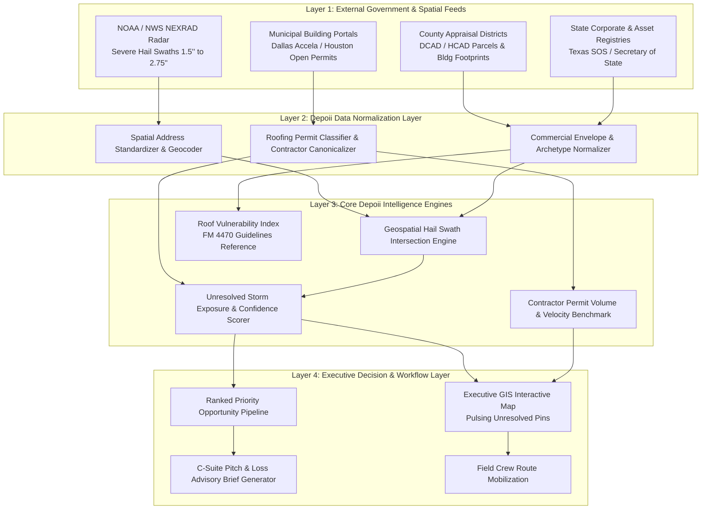

# DEPOII™ — Commercial Roofing Opportunity & Market Intelligence Engine
### Executive Product Specification, Architectural Framework & Strategic Blueprint

---

## 1. Executive Summary & Mission Statement

**DEPOII** is the first **Decision Intelligence & Opportunity Engine** designed exclusively for executive leadership, business development directors, and principal operators in the **commercial roofing industry**.

### The Core Premise:
> **"Depoii tells commercial roofing companies where money is about to appear before their competitors even know the storm hit."**

Unlike generic storm-tracking tools (HailTrace, Hail Recon) that cater to residential door-knockers with raw radar maps, and unlike generic CRM enrichment tools (Apollo, ZoomInfo) that know nothing about commercial building assemblies, **Depoii bridges the gap between atmospheric radar physics, county property appraisal records, municipal permit filings, and institutional C-suite decision-makers.**

```
┌────────────────────────────────────────────────────────────────────────┐
│                          THE DEPOII ENGINE                             │
│                                                                        │
│   RAW EXTERNAL DATA           SPATIAL & RISK ENGINES     EXECUTIVE ROI │
│  • NOAA Radar / NEXRAD   ──┐                           ┌─► 72h Crew Routes   │
│  • County Appraisals     ──┼──► Geospatial Cross-Join ─┼─► Unresolved Leads  │
│  • Municipal Permits     ──┤    & Confidence Scoring   ├─► Competitor Intel  │
│  • Corporate Registry    ──┘                           └─► C-Suite Briefs    │
└────────────────────────────────────────────────────────────────────────┘
```

---

## 2. The Commercial Roofing Problem ($30B+ Market)

In the United States, commercial reroofing represents over **$30 Billion** in annual transaction volume. A single commercial reroofing contract ranges from **$80,000 to $2,500,000+**. Yet commercial contractors operate with primitive intelligence:

1. **The Residential Trap:** Existing storm apps sell weather radar overlays to door-knockers. Commercial building owners, institutional asset managers, and REITs do not answer door knocks. Canvassing industrial parks blindly burns thousands of dollars in estimator payroll.
2. **The Municipal Lag:** By the time a commercial roofing permit is approved in a city portal, **a competitor has already signed the contract 60 to 90 days earlier.** Waiting for permit feeds means you are fighting for scraps.
3. **The Unresolved Damage Gap:** Following a severe convective hail storm, commercial building owners are often **unaware** that their low-slope membranes suffered micro-fractures, ballast displacement, or substrate crushing. If left uninspected, interior water leaks appear 9 to 18 months later—often after the insurance carrier's statutory notice window has narrowed.
4. **Competitor Blind Spots:** CEOs rarely have objective, real-time visibility into which competitors (e.g., KPost, Empire, CentiMark) are pulling permits and consolidating territory in their key submarkets.

---

## 3. The 6 Executive Decisions Depoii Answers

Instead of presenting an overwhelming, data-heavy dashboard, Depoii is built around the **Monday Morning CEO Test**—answering six high-stakes business questions:

| Executive Decision | Depoii Intelligence Module | Actionable Outcome |
| :--- | :--- | :--- |
| **1. Where to deploy crews?** | **NOAA Severe Hail Swath Spatial Intersection** | Identifies exact geographic corridors with high density of large-footprint commercial roofs exposed to 1.5"+ hail. |
| **2. Who should we inspect?** | **Unresolved Storm Exposure Pipeline** | Delivers a ranked roster of commercial properties inside the hail swath that have **no record of a repair permit filed**, weighted by a transparent Confidence Score. |
| **3. Who do we contact?** | **Decision-Maker Asset Intelligence** | Surfaces the property owner of record, asset management firm, and facility director. |
| **4. What is our technical pitch?** | **Automated C-Suite Loss Advisory Brief** | Generates an institutional advisory document citing exact storm date, radar reflectivity, estimated membrane archetype, and ASTM C1153 infrared moisture survey recommendations. |
| **5. Where are competitors winning?** | **Competitor Permit Velocity & Market Share** | Tracks verified municipal permits pulled by rival contractors and maps their territory expansion in real time. |
| **6. What is the statutory urgency?** | **TDI Statutory Period Advisory Window** | Monitors the state insurance notice deadline (e.g., Texas TDI 24-month advisory period) to give owners non-adversarial urgency to act. |

---

## 4. Architectural Framework & The "Data Truth" Layer

Depoii adheres to **strict data provenance**, cleanly separating verified government records from modeled machine intelligence.



### Data Sources & Honest Data Provenance:
1. **NOAA National Weather Service (NWS):**
   * High-resolution NEXRAD radar reflectivity (dBZ) and Dual-Polarization Hail Detection Algorithm (HDA / MESH).
   * *Provenance Note:* MESH hail sizes are modeled radar estimates; Depoii labels hail sizes as "Radar-Indicated Hail Envelope" rather than absolute ground-measured truth until field-verified.
2. **County Appraisal Districts (e.g., Dallas CAD, Harris County CAD):**
   * Parcel boundaries, building footprint square footage, property use codes (Warehouse, Industrial, Office, Retail), effective construction year (roof age baseline), and deed owner of record.
   * *Critical Provenance Truth on Roof Chemistry:* County tax records **do not record membrane type** (TPO vs. PVC vs. EPDM). Depoii classifies roofs into **"Probable Commercial Archetypes"** (e.g., *Industrial Logistics built 2004+ $\rightarrow$ Single-Ply TPO Archetype*; *Pre-1990 Distribution $\rightarrow$ Multi-Ply Built-Up Asphalt Archetype*) unless verified by municipal permit filings. Physical membrane confirmation is explicitly assigned to the contractor's field survey.
3. **Municipal Permit Portals (e.g., City of Dallas Accela Citizen Access):**
   * Live permit tracking (e.g., `COM-ROOF-26-000300`).
   * Scope of work, listed licensed roofing contractor, and declared job valuation.

---

## 5. Detailed Feature Breakdown & Regulatory Compliance

### Feature 1: Interactive NOAA Hail Swath & Spatial Intersection Map
* **Dual Hail Footprint Contours:** Displays the verified NOAA severe storm envelope (outer amber swath for 1.5"+ hail) and core destructive zone (crimson swath for 2.5"+ hail).
* **Reactive Parcel Markers (`⚡`):** Real commercial property pins situated inside the damage polygon dynamically pulse in crimson.
* **In-Map HUD Selector:** Executive can toggle between historical severe supercells (e.g., May 28, 2024 North Dallas 2.75" hail event, June 13, 2023 Denton/Carrollton squall) and watch the map dynamically recalculate affected parcels.

### Feature 2: Unresolved Storm Exposure Pipeline (Multi-Factor Confidence Scoring)
Rather than making dangerous claims of omniscience ("this roof is guaranteed damaged"), Depoii calculates an **Opportunity & Confidence Score (0–100)**:

$$\text{Opportunity Score} = w_1(\text{Hail Radar Severity}) + w_2(\text{Estimated Roof Age}) + w_3(\text{Building Footprint}) + w_4(\text{Permit Absence})$$

Each target property includes a transparent proof card:
* **Severe Hail Exposure:** 2.5" Radar-Indicated Core Swath (`Score: 94/100`)
* **Roof Age Baseline:** 22 Years Old (`High Vulnerability`)
* **Municipal Record:** Zero roofing permits filed since storm date (`Confirmed Unresolved`)
* **Estimated Pipeline Value:** e.g., $360,000 (based on $14/sq ft commercial membrane replacement benchmark).

### Feature 3: Competitor War Room & Estimated Permit Share
* Aggregates all commercial roofing permits across the submarket to calculate **Market Share by Volume**.
* Distinguishes established regional leaders (e.g., KPost Roofing & Waterproofing, Empire Roofing) from out-of-state "storm chaser" surges.
* Labeled as **"Estimated Permit Volume / City Filing Value"** to maintain 100% financial credibility without claiming access to private contractor tax returns.

### Feature 4: Roof Vulnerability Index (FM 4470 Guidelines Reference)
* References Factory Mutual (FM) 4470 approval criteria (Class 1-SH Severe Hail, Class 1-VSH Very Severe Hail) as an engineering benchmark for comparative impact risk.
* Recommends standard **ASTM C1153 Infrared Roof Moisture Surveys** to verify subsurface moisture intrusion without making unverified chemical claims.

### Feature 5: Texas UPPA Compliance & Statutory Advisory Notice
* **Regulatory Guardrail (Tex. Ins. Code § 4102):** In Texas, roofing contractors are strictly prohibited from acting as public adjusters or giving formal insurance claim adjusting advice (Unauthorized Practice of Public Adjusting).
* Depoii strictly adheres to this statute:
  * The advisory brief is formatted as a **"Structural Condition & Warranty Integrity Audit"**, not insurance advice.
  * The statutory deadline is framed as a **"TDI Statutory Period Advisory Notice (Standard 24-Month Advisory Window)"**, encouraging the owner to consult their licensed insurance professional or risk management team while the contractor provides objective physical damage documentation.

### Feature 6: Executive C-Suite Pitch & Loss Advisory Brief Generator
* With one click, Depoii generates an institutional advisory document formatted for Property Directors, Asset Managers, and CFOs.
* Includes exact storm dates, satellite aerial footprints, tenant lease indemnity risk analysis, infrared moisture testing recommendations, and professional, non-adversarial documentation language.

---

## 6. The Proprietary Long-Term Moat: Closed-Loop Feedback

The long-term value of Depoii is **not the AI model or the UI**. Anyone can build a map. The defensible economic moat is the **Closed-Loop Outcome Database**:

```
DEPOII PREDICTION
  "8110 Skillman St has 89/100 Opportunity Score"
       │
       ▼
ROOFING CONTRACTOR INSPECTION
  Crew deployed with infrared / drone survey
       │
       ▼
FIELD OUTCOME LOGGED
  [x] Subsurface saturation verified beneath membrane
  [x] Full roof replacement scope approved
  [x] $340,000 contract awarded to contractor
       │
       ▼
MODEL WEIGHTS UPDATED
  Depoii's predictive engine refines scoring
  for all similar building archetypes and storm angles
```

After 10,000 recorded contractor inspections across Texas, **Depoii's prediction accuracy becomes impossible for any competitor to duplicate.**

---

## 7. Solving Seasonality: Go-To-Market & Pricing Strategy

### The Seasonality Solution (The "Winter Churn" Defense):
Hail storms in Texas occur primarily between March and July. To eliminate seasonal cancellations:
1. **Annual Subscriptions Only (12-Month Commitments):** Contracts are billed annually ($12,000–$24,000/year) or structured with 12-month non-cancelable agreements.
2. **Year-Round Capital Replacement Module:** During the fall and winter off-season, Depoii shifts focus to **Capital Reroofing & Warranty Expiration Planning**:
   * Identifying commercial roofs exceeding 18–25 years old.
   * Tracking lease renewals and tenant ingress exposure for year-end corporate capital budgeting.
   * Monitoring new municipal commercial development permits for upcoming subcontractor bid opportunities.

### Staged Rollout Strategy:

#### Phase 1: The DFW 50-Lead Pilot Wedge (Months 1–3)
* Hand-curate 50 high-priority commercial properties in the May 28, 2024 Dallas hail corridor using Depoii's live platform.
* Present the live interactive dashboard and briefs directly to 3–5 commercial Business Development Directors (e.g., KPost, Empire, Texas Roof Management).
* Validate conversion rate and willing-to-pay threshold.

#### Phase 2: Regional Texas Expansion (Months 4–12)
* Dallas–Fort Worth, Houston (Harris County), Austin (Travis County), and San Antonio (Bexar County).
* Target: 30–50 regional commercial contractor accounts.

#### Phase 3: National Catastrophe & Industrial Belt (Year 2+)
* Oklahoma, Kansas, Missouri, Colorado, Florida, and the Midwest.

### Tiered Subscription Tiers:

| Plan | Target Audience | Annual Price | Core Capabilities |
| :--- | :--- | :--- | :--- |
| **Operator** | Independent commercial estimators & field PMs | **$5,988 / yr** ($499/mo equiv) | Real-time NOAA radar swaths, parcel search, probable roof archetypes, municipal permit lookup. |
| **Executive Pro** | Mid-size commercial roofing contractors ($10M–$30M rev) | **$14,388 / yr** ($1,199/mo equiv) | Full Unresolved Storm Exposure pipeline, decision-maker enrichment, C-suite brief generator, 1 metro territory. |
| **Enterprise War Room** | Regional & national contractors ($30M+ rev) | **$26,388 / yr** ($2,199/mo equiv) | Multi-territory, competitor permit velocity tracking, CRM API integration, customized loss advisory briefs. |

---

## 8. Summary: Why Depoii Wins

Depoii succeeds because it respects the commercial roofing sales cycle and maintains total honesty about data provenance.

It is a **precision revenue instrument**:
1. It cuts commercial prospecting time by **80%**.
2. It elevates the roofer from an unwelcome door-knocker to a **trusted structural and capital budgeting advisor**.
3. It keeps contractors **100% compliant with Texas UPPA regulations**.
4. It ensures that every marketing and crew deployment dollar is aimed squarely at the **highest-probability commercial roofs in the market**.
